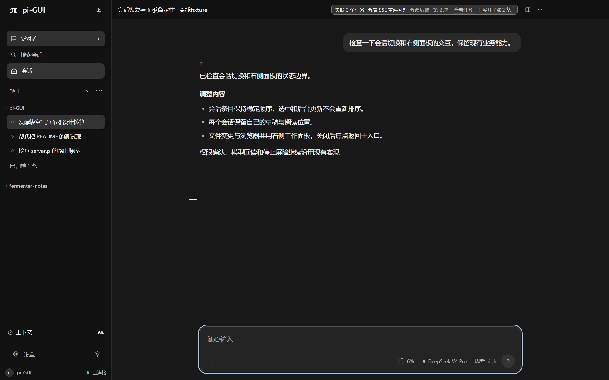

<div align="center">


# Pi GUI

### 为 Pi Coding Agent 打造的本地桌面工作空间

在一个窗口中管理项目、会话、模型、工具执行与文件变更。

Windows · 本地优先 · 多会话 · 可视化工作流

[](https://github.com/HYJ1817/pi-gui/releases/latest)
[](https://github.com/HYJ1817/pi-gui/actions/workflows/ci.yml)
[](LICENSE)

[下载最新版](https://github.com/HYJ1817/pi-gui/releases/latest) · [快速开始](#快速开始) · [文档](docs/README.md) · [反馈问题](https://github.com/HYJ1817/pi-gui/issues)



<sub>界面截图使用离线演示数据，展示的是已实现的桌面界面。</sub>

</div>

## 主要功能

- 项目与会话：按项目整理历史会话，支持搜索、分叉、归档以及多会话工作。
- Agent 对话：流式消息、Markdown、Thinking、工具执行时间线及文件附件。
- Git 变更：在右侧工作面板查看文件和 Diff，支持审阅与受控撤销。
- 模型管理：切换供应商、模型与思考等级，管理认证和项目备用模型。
- 工作面板：按需打开内置浏览器、文件变更、Specs 和协同工作区。
- 任务与审阅：创建依赖任务，组织 Agent 执行，检查结果和验证证据。
- 扩展能力：管理已有 Skills、Extensions 和 Pi 原生 MCP；部分能力需要另外安装对应扩展。

[查看更多界面截图](designs/ui-ux-2026-10-31/evidence/production-refined-verified/) · [功能与技术文档](docs/README.md)

## 快速开始

### 1. 安装 Pi

Pi GUI 使用本机独立安装的 [Pi Coding Agent](https://github.com/earendil-works/pi)，需要先配置可用的模型供应商。

安装 [Node.js](https://nodejs.org/) 22.19 或更新版本后运行：

```bash
npm install -g @earendil-works/pi-coding-agent
pi --version
```

### 2. 下载 Pi GUI

从 [GitHub Releases](https://github.com/HYJ1817/pi-gui/releases/latest) 选择 Windows 版本：

| 安装方式 | 下载文件 |
| --- | --- |
| 安装版 | `Pi-GUI-Setup-<版本>.exe` |
| 便携版 | `Pi-GUI-<版本>-portable.zip` |

安装版可从开始菜单启动；便携版解压后运行 `Pi GUI.exe`。

### 3. 开始工作

打开 Pi GUI，添加本地项目文件夹，在输入框中描述任务。完成后可通过右侧工作面板检查文件变更与执行结果。

## 从源码运行

<details>
<summary>开发环境与命令</summary>

需要 Node.js 22.19 或更新版本，并预先安装和配置 Pi。

```bash
git clone https://github.com/HYJ1817/pi-gui.git
cd pi-gui
npm install
npm run app
```

仅运行本地 Web 界面可使用 `npm start`，并访问 `http://127.0.0.1:7788`。

测试：`npm test`。构建和发布流程见 [开发文档](docs/development.md) 与 [测试文档](docs/testing.md)。

</details>

## 本地运行与隐私

Pi GUI 使用 Electron、Node.js 与原生 JavaScript，通过本机 RPC 连接 Pi。项目和会话保存在本地，不要求 Pi GUI 云端账户，也不上传产品使用遥测。

使用云端模型时，模型请求会发送给所配置的服务商。版本检查和用户自行启用的扩展也可能访问网络。Agent 可执行命令及修改本地文件，使用前请确认工作目录与工具权限。

[隐私声明](PRIVACY.md) · [安全说明](docs/security.md) · [架构](docs/architecture.md)

## 文档与支持

[使用与能力](docs/README.md) · [更新与升级](docs/updates.md) · [开发指南](docs/development.md) · [提交问题](https://github.com/HYJ1817/pi-gui/issues)

## 代码签名与许可证

Windows 安装程序使用 [SignPath.io](https://signpath.io) 的免费代码签名服务，证书由 [SignPath Foundation](https://signpath.org) 提供。

Free code signing provided by SignPath.io, certificate by SignPath Foundation.

[代码签名政策](CODE_SIGNING_POLICY.md) · [MIT License](LICENSE)
