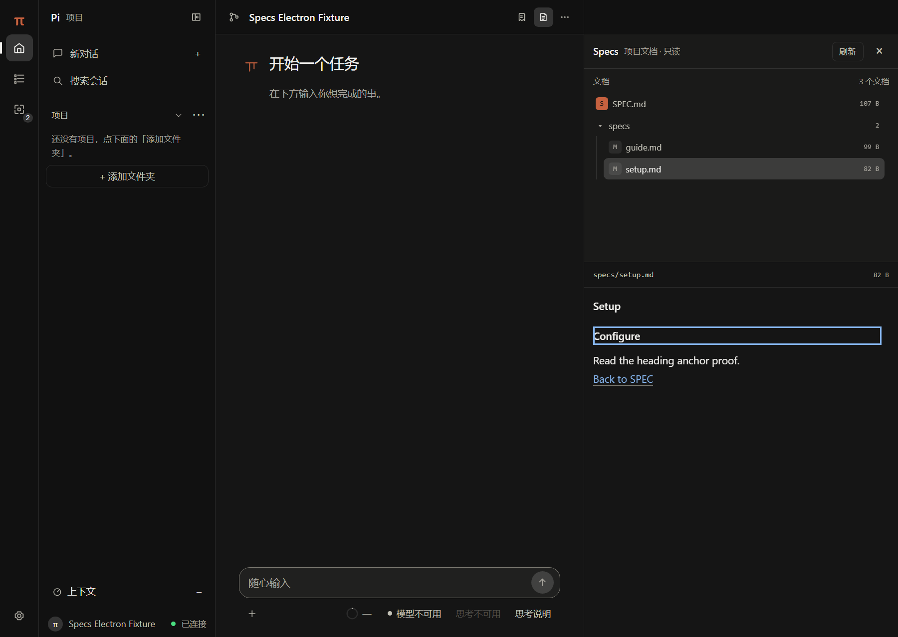
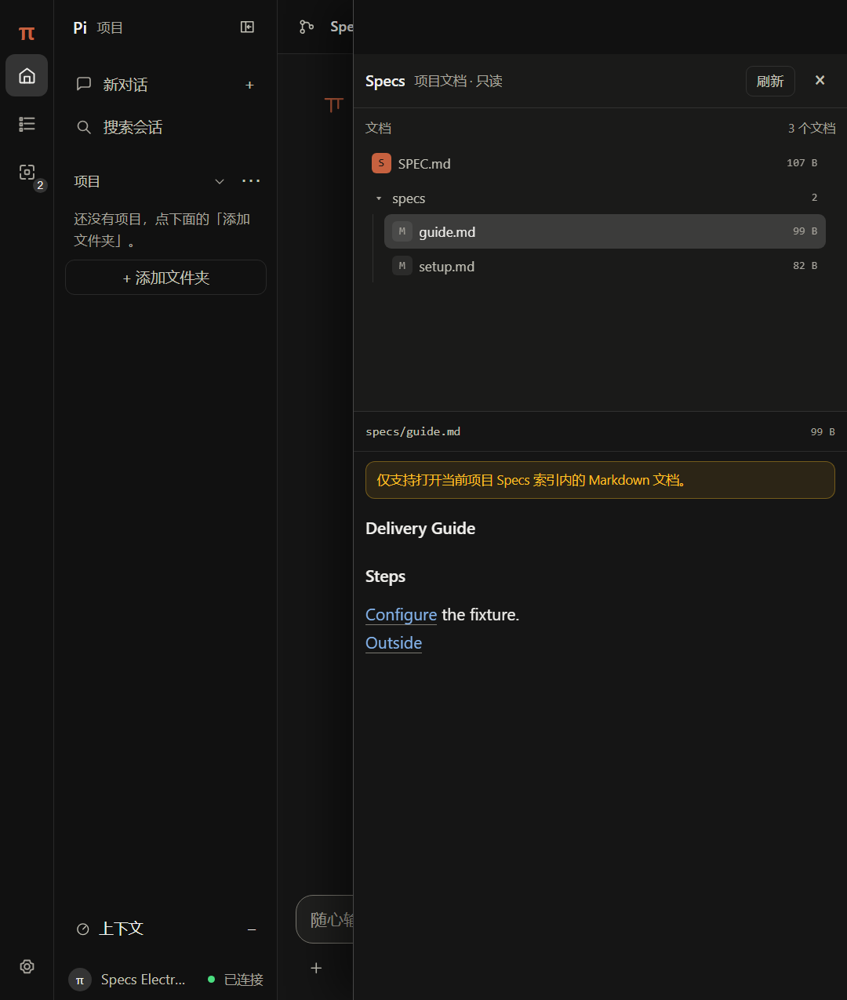
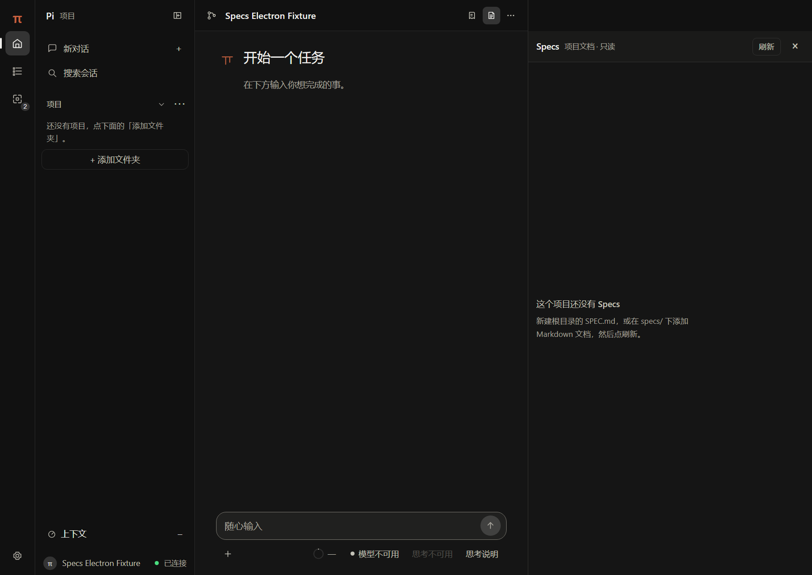

# T1 只读 Specs 项目知识系统验收报告

日期：2026-10-21
分支：`codex/t1-specs`
基线：`origin/main` / `8de1271`（`v0.27.0`）
范围：T1 第一阶段，只读 Specs 文档树、Markdown 预览、项目 / Worktree 隔离、手动刷新。

## 一、结论

**通过 T1 第一阶段本地验收。** 未发现可证实的阻断问题或渲染进程可触发的项目外文件读取；独立复审发现的
“focused 会话切换失败时仍保留旧文档树”已修复并补测。

本次没有推送、合并、发版或修改 Pi 本体 / RPC / 会话存储。

## 二、功能范围

- 发现当前项目根的 `SPEC.md`，以及 `specs/` 下递归 `.md` / `.markdown` 文档。
- 在现有右栏增加一个 Specs 入口，不增加 Global Rail 一级导航或其他重复入口。
- 文档树支持目录展开 / 折叠、当前文档高亮和切换。
- 正文复用现有 `public/markdown.js`，支持页内标题锚点与已索引文档间相对链接。
- 切换经典项目、受控 Worktree 或 focused parallel conversation 时重载对应工作区。
- 未选择项目、无 Specs、扫描失败、部分扫描、文件过大、非法 UTF-8、文件删除均安全降级。
- 刷新按钮重新发现；不建立文件监听，不写项目文件。

## 三、安全与架构证据

- 前端只收到不透明文档 ID 与 workspace token，不提交绝对路径或任意文件路径。
- 正文请求必须同时匹配当前 workspace token 与 generation；不同 Worktree 或迟到旧响应返回
  `stale_workspace`。
- 经典项目使用 `server/runtime.js` 的 authoritative cwd / generation；focused 会话复用 Changes 的
  conversation scope，由后端 Runtime Registry / Ordinary Sessions 解析 `workspace.cwd`。
- 所有读取继续经过 `lib/safe-path.js` 的 lexical + realpath + parent 校验；目录 junction、文件符号链接、
  项目外目标和非普通文件被拒绝或跳过。
- 打开文件后再次检查 `lstat` / realpath 与 pre-open / post-open `dev + inode`，降低本地文件替换竞态。
- 单文档上限 256 KiB；读取始终消费 `上限 + 1` 字节，因此读取期间增长不会被静默截断。
- UTF-8 严格解码，NUL / 二进制内容按 `invalid_text` 拒绝。
- Markdown 继续使用“先整体转义，再生成白名单标签”的既有渲染器；远程图片不加载，危险 scheme 不成为链接。
- `/api/specs*` 经过现有 token、Origin 和 loopback 访问控制，并接入现有测试链。
- 未增加依赖；`public/`、`server/` 变更已重建 Electron 产物。

## 四、代码变更

主要新增：

- `server/specs.js`：发现、索引、有界读取、workspace token、HTTP 处理。
- `public/specs-panel.js`：右栏树 / 正文、刷新、锚点、相对链接和陈旧响应防护。
- `public/specs-tree.js`：纯树构建与链接解析。
- `public/specs.css`：沿用右栏、Markdown 与 UI token 的样式增量。
- `tests/specs.cjs`、`tests/specs-ui.cjs`、`tests/specs-electron.cjs`。

主要接线：

- `server.js` / `server/router.js`：装配只读 Specs API。
- `public/index.html` / `public/app.js`：现有顶栏右栏按钮组中的唯一 Specs 入口。
- `public/markdown.js`：可选的标题 ID；聊天 Markdown 默认输出不变。
- `public/api.js`：Specs API，复用 focused conversation scope header。
- `tests/modules.cjs`、`tests/gui-browser-stop.cjs`、`tests/stop-barrier.cjs`：路由与装配测试同步。
- `docs/specs.md`、`docs/architecture.md`、`docs/testing.md`、`README.md`。

## 五、测试结果

### 定向功能

| 检查 | 结果 |
|---|---|
| `npm run test:specs` | **43/43**：后端 18/18；jsdom UI 25/25；skipped 0 |
| `npm run test:specs:electron` | **10/10**；真实 production Electron entry；skipped 0 |
| `node tests/modules.cjs` | **119/119** |
| `node tests/smoke.cjs` | **1338/1338** |
| `node tests/server-security.cjs` | **39/39** |
| `node tests/electron-guard.cjs` | **123/123** |
| `npm run test:worktrees` | **86/86**：lifecycle 56、HTTP 14、UI 16 |
| `node tests/attempt-lifecycle.cjs` | **98/98** |
| `npm run test:ui4` | approval 44/44、feedback 27/27、integration 55/55 |

### Canonical 全量测试链

`npm run pretest`：**163 leaves across 5 groups; coverage exact**；CI/release/NSIS 预检通过。

执行 `npm test` 时，测试链在 `native-provider-quota` 遇到本机 Windows 环境限制：
esbuild 对 `%TEMP%\\pi-native-quota-*\\bundled-sdk.cjs` 返回 `Access is denied`。这不是断言失败。

处置：

- `native-provider-quota` 在仓库内可写的 `TEMP=C:\pi-GUI\.probe\t1-native-temp` 下重跑：
  **53/53 passed**。
- 其余尚未执行的 leaves 随后逐条执行；`project-config` 的同类 esbuild 检查在仓库内 TEMP 下重跑：
  **115/115 passed**。
- 两个 VM 装配 harness 补齐新 `specs` 依赖后，失败 leaf 分别重跑：
  `gui-browser-stop` **12/12**，`stop-barrier` **17/17**。
- 其后 **54 个剩余 leaves 全部通过**，输出 `REMAINDER_OK=54`。

因此 163 个 canonical leaves 均有实际通过记录；但没有一次单命令 `npm test` 在本机同时满足
“fixture 在 Git 仓库外”和“esbuild 可写”这两个相互冲突的 TEMP 要求，报告中保留此环境例外。

### 构建与打包

- `npm run build:app -- --rebuild --output-root <fresh-dir>`：成功。
- `Pi GUI.exe`：**234.9 MB**；整包：**328.6 MB**。
- 在无仓库祖先、无 `node_modules` 回退的中性目录运行 `tests/app-check.cjs`：**26/26 passed**。
- 覆盖随包资源、图标、内嵌后端、fake Pi 启动、RPC ready、静态资源、路径拒绝、PDF/DOCX 抽取、
  上传数据目录、无项目降级。

## 六、真实 Electron 截图

Specs 入口、跨文档链接、标题锚点、未索引路径拒绝、1200/720 布局和空态均由真实 Electron
`WebContents` 执行并截图；测试不依赖真 Pi、模型或真实用户项目。

### 1200 宽，文档树与正文

### 720 宽，覆盖式右栏

### 无 Specs 空态

## 七、审查结果

独立复审首轮：

- Important 1：focused scope 改变后若新索引失败，旧文档树可能继续显示。
- Nit 2：不完整扫描未提示；文件增长读取可能只显示旧长度前缀。
- 无已确认的任意读取或静态路径穿越缺陷。

修复后复审：

- 三个发现均标记 **Resolved**。
- focused scope 切换同步清空旧树并补测。
- `incomplete` 扫描显示警告并补测。
- 读取缓冲固定为上限加一，并增加 pre/post-open identity 与 realpath 复核。
- 未发现新增功能回归。

残余风险：同时持有本地文件系统写权限的外部程序，在极窄窗口内主动轮换路径 / 符号链接仍属于本机竞态；
本轮已用多次 realpath、`lstat`、`fstat`、`dev + inode` 检查收窄，但没有声称这是 OS sandbox。

## 八、回滚方式

- 回退本分支提交即可移除 Specs API、右栏入口、样式与测试接线。
- Specs 没有持久化索引、项目配置迁移或会话格式变化，因此回滚不需要数据迁移。
- 已重建的 `dist-app` 属于可再生产物；如需回到验收前界面，重新构建上一提交即可。

## 九、已知限制与第二阶段建议

当前限制：

- 只读；不创建、修改、删除文档，不做 Agent 自动维护。
- 只发现根 `SPEC.md` 与 `specs/` 下 Markdown；不读取 frontmatter 图、任务图或全局索引。
- 手动刷新；没有文件监听。
- 文档上限 256 KiB、列表上限 256 个文件；超出时明确标出截断 / 不完整。
- 拒绝项目外或未索引相对链接；不把外部文件转成其他预览。

建议第二阶段：

1. 用去抖、generation 绑定的文件监听替代手动刷新，同时保留当前手动入口和 stale 防护。
2. 在保持后端文件身份边界的前提下读取 frontmatter，提供 role / parent / status 树与稳定 slug。
3. 增加文档搜索、反向链接和引用关系，但不要把“发现索引”扩张成任意文件浏览器。
4. 持久化每个 workspace 的展开与最后文档，并补树键盘导航。
5. 增加真实两个 Worktree 的 Electron 切换验收，继续以 workspace token + generation 做旧响应拒绝。
6. 最后再评估 Agent 自动维护和知识图谱；它们应建立在当前只读索引与安全读取契约之上。
