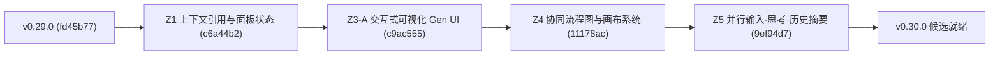

# Z5-Final：全阶段集成与发布就绪审计验收报告

**日期**：2026-10-27（Asia/Shanghai）  
**本轮唯一执行 Agent**：Antigravity（独立单 Agent 执行，无子 Agent，只读审计优先）  
**基线状态与依据**：
- main 精确 HEAD：`9ef94d7ab9b2240eed9b1d04cf0975a99adec10e`（合并 PR #40：历史工具摘要 UI 集成与最终收尾）
- 最新公开 Release：`v0.29.0`（commit `fd45b7789c395bdb7a776496a93cf0eb5d9e5cc4`，tag `v0.29.0`）
- 依据规范：[AGENTS.md](../AGENTS.md)、[REVIEW.md](../REVIEW.md)、[docs/testing.md](testing.md)、[docs/releasing.md](releasing.md)

---

## 一、审计概述与工作区身份

本轮审计严格在独立 Worktree 中执行，未修改其他分支或用户当前工作区：

| 项目 | 审计核验值 | 说明 |
| :--- | :--- | :--- |
| **仓库** | `https://github.com/HYJ1817/pi-gui` | 远端状态已通过 `git fetch origin --tags` 确认 |
| **审计 Worktree** | `C:\Users\21022\.codex\worktrees\z5-final-audit\pi-GUI` | 基于 `origin/main`（`9ef94d7`）创建的独立环境 |
| **分支名称** | `codex/z5-final-audit` | 独立审计分支，未向 main 追加生产修改 |
| **main CI 证明** | Run ID: [`40458644897`](https://github.com/HYJ1817/pi-gui/actions/runs/40458644897) | Push 事件，`9ef94d7`，耗时 18m25s，8 个 job 全部 success |
| **Canonical 测试集** | **225 / 225** 完整通过 | core 149, ui 24, security 27, native 4, faults 21 |
| **当前版本号** | `0.29.0`（`package.json`） | 本轮未修改版本号、Release Notes 或发布配置 |
| **候选发布版本** | **`v0.30.0`**（建议） | 包含 Z1, Z3-A, Z4, Z5 多项向下兼容重大新功能 |

---

## 二、Z5 各阶段集成结论

Z5 包含 4 个连续阶段，均已先后通过独立验证并合并入主线：

### 1. Z5-1：并行会话输入可靠性与草稿安全持久化（PR #37，commit `ec336ad`）
- **中文输入法保护**：监听 `compositionstart` / `compositionend`，守卫 `isComposing` 与 `keyCode === 229`，杜绝输入法候选词确认时误发 prompt。
- **发送快捷键守卫**：支持普通 `Enter` 发送；`Shift+Enter` 换行且保留原生文本流，不触发 `preventDefault()`。
- **A/B 草稿完全隔离**：纯文本草稿通过严格 5 字段 locator 隔离（`projectId:workspaceId:workspaceEpoch:conversationId:nativeSessionId`），会话切换互不影响。
- **草稿恢复与清空**：页面刷新或重开会话自动恢复草稿，清空后绝不因防抖重绘而复活。
- **迟到 ACK 隔离**：引入 `draftRevision`，旧请求的 ACK 响应绝不清空用户当前正在输入的新草稿。

### 2. Z5-2：Classic / Runtime 思考等级合同统一（PR #38，commit `300717f`）
- **统一判定纯策略**：`public/thinking-availability.js` 统一输出 `{state, levels, usable, label, detail}`。
- **Pi 原生回读优先**：即使静态 capability 标注为 `false` 或 `unknown`，只要 Pi 原生回读提供可用档位，即允许调节，不伪造能力元数据。
- **严格安全降级**：无模型、读取失败、尚未确认或仅有 `off` 时，明确禁用调节并给出固定原因提示，不虚假合成预设。
- **异步响应隔离**：HTTP ACK 仅代表传输成功，必须等待原生 `response` 与完整回读确认后才更新 UI；旧 Owner、迟到响应绝不污染当前会话。

### 3. Z5-3：历史只读工具结果摘要后端投影（PR #39，commit `6eddc3e`）
- **有界只读安全投影**：限制末尾 4 MiB 读取窗口、末 4096 行、最近 100 次工具调用；正文保留原有 800 条上限与原顺序。
- **脱敏与最小化**：仅投影 `toolName`、`status`（completed/error/unknown）、`source` 及 `messagePosition`；工具名仅允许受控 ASCII 白名单，未知工具统一标为 `unknown_tool`；绝不泄露工具参数、命令、文件路径或输出正文。
- **精准插入位置**：后端计算基于当前返回 `messages[]` 的 `messagePosition`（0 到 `messages.length`），不泄露底层私有 ID 或行号。

### 4. Z5-3B：历史工具摘要 UI 渲染与收尾（PR #40，commit `9ef94d7`）
- **低干扰只读行**：工具行采用紧凑样式（`span.rtc-history-tool`），通过 `textContent` 写入 `toolName · 状态文案`，禁止点击与任何执行操作。
- **状态文案精准映射**：`completed` 映射为“已记录完成”，`error` 为“结果报错”，`unknown` 为“状态未知”。
- **位置未确认安全隔离**：`messagePosition=null` 或非法位置安全降级至独立的顶部未确认容器，绝不崩溃正文。
- **搜索跳转隔离**：正文显式标注 `.rtc-history-message`，搜索跳转不因工具行的插入而发生位置偏移。
- **生命周期保护**：只读历史浏览不启动 Pi，不占运行名额；返回实时或恢复会话时彻底清空历史工具 DOM。

---

## 三、全阶段联合场景实测证据（Z5-Final Joint Electron）

为彻底杜绝各阶段代码合并后的隐性交互冲突，本轮编写了专门的自包含沙箱联合测试：  
- 夹具：[`tests/fixtures/z5-final-joint-electron.cjs`](file:///C:/Users/21022/.codex/worktrees/z5-final-audit/pi-GUI/tests/fixtures/z5-final-joint-electron.cjs)  
- 运行器：[`tests/z5-final-joint-electron.cjs`](file:///C:/Users/21022/.codex/worktrees/z5-final-audit/pi-GUI/tests/z5-final-joint-electron.cjs)  
- 运行环境：真实 Electron `44.4.3`，Chromium `152.0.7977.130`，Windows 11 x64，`sandbox: true, contextIsolation: true, nodeIntegration: false`。

### 8 步联合场景执行记录（全部通过，22/22 断言）

| 场景步骤 | 验证目标 | 实测结果 | 截图证据 |
| :--- | :--- | :--- | :--- |
| **步骤 1** | A 运行时（busy），在 B 输入草稿 | A 的繁忙状态不影响 B；草稿正常输入并防抖持久化 | [`z5-final-step1-a-running-b-draft.png`](assets/z5-final/z5-final-step1-a-running-b-draft.png) |
| **步骤 2** | 切到历史会话阅读工具摘要 | 正文与工具行按位置呈现；completed/error/unknown 准确映射；未确认项独立隔离；不拉起 Pi | [`z5-final-step2-history-tool-summary.png`](assets/z5-final/z5-final-step2-history-tool-summary.png) |
| **步骤 3** | 返回 B，草稿完整保留 | 从历史返回后，B 的输入框内容完好无损；历史工具行彻底清除 | [`z5-final-step3-b-draft-intact.png`](assets/z5-final/z5-final-step3-b-draft-intact.png) |
| **步骤 4** | B 切换模型和思考等级 | 切换模型至 `m-advanced`，思考等级设为 `high`；原生回读确认后 DOM 同步就绪 | [`z5-final-step4-b-model-thinking.png`](assets/z5-final/z5-final-step4-b-model-thinking.png) |
| **步骤 5** | 迟到 ACK 不影响当前输入 | 发送拦截期间输入追加文本；旧 ACK 到达因 `draftRevision` 隔离绝不清空当前新草稿 | [`z5-final-step5-delayed-ack.png`](assets/z5-final/z5-final-step5-delayed-ack.png) |
| **步骤 6** | 关闭 B、打开历史、再恢复 | B 关闭后呈现 dormant；打开只读历史说明；点击“恢复会话”发起 resume，DOM 干净重置 | [`z5-final-step6-close-history-resume.png`](assets/z5-final/z5-final-step6-close-history-resume.png) |
| **步骤 7** | 重启应用后检查会话与草稿边界 | 窗口重载（reload）后，B 的草稿自动从本地存储恢复；A 草稿独立为空，无数据串扰 | [`z5-final-step7-restart-draft-boundary.png`](assets/z5-final/z5-final-step7-restart-draft-boundary.png) |
| **步骤 8** | 安全边界与权限核查 | 全程无未授权工具执行；无审批泄漏；无焦点抢占；渲染进程零控制台报错 | 见 [`results.json`](assets/z5-final/results.json) |

---

## 四、测试证据层级对照表

严格按 [AGENTS.md](../AGENTS.md) 与 [docs/testing.md](testing.md) 区分测试环境与验证级别：

| 验证层级 | 覆盖范围 / 套件名称 | 实测结果 | 证据状态 |
| :--- | :--- | :--- | :--- |
| **1. Canonical CI (main)** | `gh run view 40458644897`（commit `9ef94d7`） | **225 / 225 叶全部 pass**，耗时 18m25s | **CI Gate Success** |
| **2. 单元与集成测试 (本地)** | `tests/runtime-conversation.cjs` | **104 / 104** pass | 本地实测通过 |
| | `tests/runtime-history-search.cjs` | **37 / 37** pass | 本地实测通过 |
| | `tests/history-tool-summary.cjs` | **36 场景，161 断言** pass | 本地实测通过 |
| | `tests/history-tool-summary-http.cjs` | **14 场景，49 断言** pass | 本地实测通过 |
| | `tests/runtime-models.cjs` | **52 / 52** pass | 本地实测通过 |
| | `tests/thinking-availability.cjs` | **34 / 34** pass | 本地实测通过 |
| | `tests/runtime-draft.cjs` | **42 / 42** pass | 本地实测通过 |
| | `tests/ui3-integration.cjs` | **23 / 23** pass | 本地实测通过 |
| **3. 正常沙箱 Electron 专项** | `tests/z5-runtime-input-electron.cjs` | **15 / 15** pass（1200/900/700px） | 截图与报告已归档 |
| | `tests/thinking-electron.cjs` | **35 / 35** pass（1200/760px） | 截图与报告已归档 |
| | `tests/z5-3b-history-ui-electron.cjs` | **16 / 16** pass（1200/900/700px） | 截图与报告已归档 |
| | `tests/z5-final-joint-electron.cjs` | **22 / 22** pass（8 联合场景） | 7 张截图已归档 |
| **4. 打包产物与 SEA 校验** | `tests/app-check.cjs`（Packaged Electron App） | **26 / 26** pass | 随包资源、无 node_modules 验证通过 |
| | `tests/exe-check.cjs`（单文件 SEA Exe） | **49 / 49** pass | 内嵌资源一致性、API 隔离验证通过 |
| | `tests/history-tool-summary-packaged.cjs` | **18 / 18** pass | App 与 SEA 内嵌后端历史工具隔离通过 |
| **5. 真实物理输入法** | Windows 微软拼音/微信输入法手动输入 | **待人工手动验证**（未自动伪造） | 明确标为未自动化覆盖 |

### 本地构建产物哈希一致性证明
通过 `npm run build:app -- --rebuild` 重建后核验：
- `build/Pi GUI.exe`（98.2 MB）：`SHA-256: E4BB5D37D84E80C174F61A0AD3C6D418F7F3474D47F926BE169DFB5E53533DBD`
- `dist-app/Pi GUI-win32-x64/Pi GUI.exe`（234.9 MB）：`SHA-256: C8755F70993AECF1DA95A2557234A3FA2B59C876F7419CA62FAB41147F01D81B`
- 产物 SHA 与 Z5-3B 提交一致，证明产物与源码完全匹配。

---

## 五、自 v0.29.0 以来的主线累积功能审计

自公开发布版本 `v0.29.0`（commit `fd45b778`）以来，主线累积了以下重大阶段性交付：



### 1. 协同图表与画布系统（Z4-1 ~ Z4-6B）
- 生产化协同流程图画布（Node/Edge 拓扑、平移缩放、网格吸附）；
- 真实 Pi Agent 协同建议队列，受控 Diff 审查与应用；
- 生产力工具条：自动布局引擎、安全图形预览、SVG/PNG 高保真导出；
- 高级交互：框选多选、批量位移/对齐、复制粘贴、键盘快捷键支持；
- 稳定性加固：40 轮混合通道 GC 取样、进程树彻底清理、无内存泄漏。

### 2. 受控 Gen UI 与交互式可视化（Z3-A）
- ````pi-gui-viz```` Markdown 交互代码块；
- 客户端图表渲染（柱状图、折线图、指标卡），严格零基线几何校验与数值安全防护；
- 消息流式渲染替换保护，防止图表 DOM 引用失效。

### 3. 上下文引用与右栏状态恢复（Z1）
- 日志概览条目一键引用至对话输入；
- 切换会话与页面重开时，右栏面板（Changes, Specs, Browser）的打开状态与滚动位置精准恢复。

### 4. 并行 Runtime 可靠性加固（Z5）
- 输入法合成中防误发送与草稿安全持久化（Z5-1）；
- Classic / Runtime 思考等级合同统一与原生回读优先（Z5-2）；
- 历史会话只读工具摘要后端投影与安全位置切片（Z5-3 / Z5-3B）。

---

## 六、发现项分级（Findings）

### Blocker (0 项)
无阻断项。所有主线代码、依赖、CI gate 与本地沙箱构建均全绿通过。

### Important (3 项)
1. **正式发版需走独立版本准备分支**：当前代码版本仍为 `0.29.0`。根据 [releasing.md](releasing.md)，不得直接推 tag，必须先建版本准备分支执行 `npm run version:set -- 0.30.0`，更新 `.github/release-summary.md`，提交后合并回 main 并等待该精确 commit 的 push CI 成功。
2. **真实 Windows 输入法物理抽样**：自动化测试虽覆盖了 `isComposing` 与 `keyCode: 229` 的所有合成事件，但物理键盘弹出的候选框（如微软拼音、搜狗输入法）仍建议用户在打包产物上进行一次人工打字确认。
3. **多阶段累积内容丰富**：自 `v0.29.0` 以来包含 Z1、Z3-A、Z4、Z5 四个大阶段的变更，Release Notes 必须清晰分块，避免用户对复杂新功能产生混淆。

### Nit (1 项)
1. **Electron 控制台废弃警告**：Electron 44 启动时输出 `(electron) 'console-message' arguments are deprecated...`，系 Electron 官方在 v44 中关于事件参数对象的提示，不影响产品功能与正常运行。

---

## 七、版本发布建议与 Release Notes 草案

### 1. SemVer 版本号建议：**`v0.30.0`**
- **依据**：本次更新包含了协同画布编辑（Z4）、交互式可视化（Z3-A）、上下文引用（Z1）以及 Runtime 并行输入与历史工具摘要（Z5）等多项重大新功能，均完全向下兼容原有 Classic/Runtime 会话与数据格式。符合 SemVer 的 `MINOR` 版本递增标准。

### 2. Release Notes 草案（可直接供 `.github/release-summary.md` 参考）

```markdown
# Pi GUI v0.30.0 更新摘要

### 🎨 协同画布与流程图编辑 (Z4)
- **可视化流程图画布**：支持节点、连接线的拖拽编辑、对齐与框选批量操作。
- **AI 协同建议流**：实时接收来自 Pi Agent 的结构化图表建议，支持只读预览与安全应用。
- **生产力工具箱**：内置流程图自动布局、高保真 SVG/PNG 导出与剪贴板复制。

### 📊 交互式可视化与受控 Gen UI (Z3)
- **图表渲染卡片**：支持在对话中直接渲染折线图、柱状图与统计指标面板。
- **流式安全保护**：强化流式输出期间图表节点的挂载稳定性，避免消息重绘时丢失交互状态。

### ⚡ Runtime 并行输入与思考加固 (Z5)
- **输入法与草稿可靠性**：彻底修复中文输入法候选确认误发送问题；未发送草稿支持跨会话隔离与自动保存恢复。
- **统一模型思考等级**：Classic 与 Runtime 统一采用基于原生 Pi 回读的推理等级策略，支持高准确度的可用性提示。
- **只读历史工具摘要**：查看历史会话时呈现安全脱敏的工具执行摘要（完成、报错、未知），不暴露敏感参数与命令正文。

### 🔗 上下文引用与视图恢复 (Z1)
- **日志引用入会话**：支持将开发日志快速引用至任务对话中。
- **面板状态恢复**：切换会话时自动恢复右侧面板的展示状态与滚动位置。
```

---

## 八、回滚方案与发版前核验清单

### 1. 回滚方案
若发布后发现任何重大环境兼容性问题：
- **Git 层面**：可随时通过 `git revert -m 1 <merge_sha>` 针对特定 PR 回滚，各阶段分支隔离清晰，无跨阶段强耦合。
- **发布产物**：GitHub Releases 仍完整保留 `v0.29.0` 的 3 个可执行安装包与 Portable zip，用户可直接下载旧版覆盖安装，数据目录向后兼容。

### 2. 发版前人工操作核验清单（须用户明确授权后执行）
- [ ] 1. 从当前最新 main 检出独立发版分支：`git checkout -b release/v0.30.0 main`
- [ ] 2. 设置三段版本号：`npm run version:set -- 0.30.0`
- [ ] 3. 编辑 `.github/release-summary.md`，同步首行版本号并写入更新内容。
- [ ] 4. 运行发版链路校验：`npm run version:check`
- [ ] 5. 提交并创建 PR，等待 PR CI 全绿并合并入 main。
- [ ] 6. 确认合并提交在 main 上的精确 push CI 成功（8 个 job 全绿）。
- [ ] 7. 用户正式下发 tag 指令，打 tag `v0.30.0` 并 push 触发自动发版工作流。

---

## 九、审计结论

> **审计判定：GO（建议进入正式发版准备流程）**  
> 全部 4 个 Z5 阶段与累积阶段（Z1, Z3-A, Z4）在 formal 应用、打包产物及正常沙箱 Electron 窗口中协同稳定，无回归，无未清阻断项。  
> 本轮已完全遵守只读约定，未执行自动 push、建 PR、合并、打 tag 或发版。交付报告交由用户独立验收。
