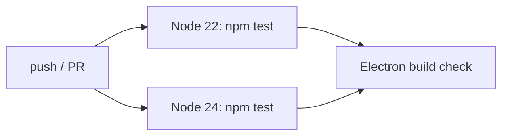
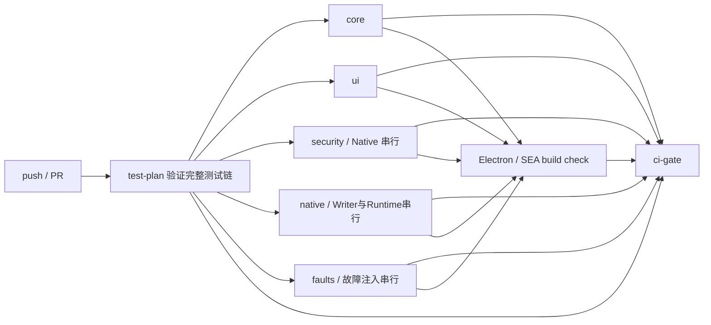

# CI 性能优化验收

## 1. 基线与提交

- 原始 `origin/main`：`cbcd6c21a147fb71946af61e2ea16a94973b0a9f`（`v0.26.0`）。
- 初始实现提交：`a8af49c`（在其之前另有审计提交 `ab40781`）。
- 分支：`codex/ci-performance-optimization`。
- PR：[HYJ1817/pi-gui#6](https://github.com/HYJ1817/pi-gui/pull/6)。
- 首次完整成功 CI：[39147743120](https://github.com/HYJ1817/pi-gui/actions/runs/39147743120)，
  行为提交 `afb03be4eb455f9d1f20fbd3a93db1ea9fceab1d`。
- 最终行为提交：`336152214e1451dfdc025a018201acb690f5f4f0`。
- 五组完整测速 CI：[39153427496](https://github.com/HYJ1817/pi-gui/actions/runs/39153427496)，
  全部 8 个 job 成功。报告归档提交只更新文档及注释，交付 HEAD 以 PR 当前提交为准；
  完整 SHA 同时列在最终交付说明，避免在报告内自引用其自身 commit hash。

## 2. 变更文件

代码与测试基建：

- `.github/workflows/ci.yml`
- `.github/workflows/release-check.yml`
- `.github/workflows/release.yml`
- `.github/workflows/signpath-sign.yml`
- `package.json`
- `scripts/test-group-plan.mjs`
- `scripts/run-test-group.mjs`
- `tests/ci-test-plan.cjs`
- `tests/ci-workflow.cjs`
- `tests/fixtures/session-revert-object-harness.cjs`
- `tests/fixtures/session-revert-retention.cjs`
- `tests/session-revert-fixture-retention.cjs`

文档与约定：

- `AGENTS.md`
- `README.md`
- `docs/testing.md`
- `docs/ci-optimization-audit.md`
- `docs/ci-optimization-acceptance.md`
- `docs/ci-optimization-results.json`（145 条真实执行记录，不是另一份可执行清单）

未修改产品依赖、Electron 版本、pi 版本、项目版本或 `package.json#engines.node`。

## 3. Node 版本

- CI、Release Check、Release 和 SignPath 均固定 Node `24.14.0`。
- 本地实测 `node --version` 为 `v24.14.0`，npm 为 `11.9.0`。
- Node 22 matrix 已删除。Node 22 不再通过持续集成验证。
- 产品 `engines.node` 保持 `>=22.19`：Pi 的协议驱动下限仍为 22.19，pdfjs 的
  `>=22.13.0 || >=24` 与开发工具的 Node 下限不要求提高产品最低版本。
- Electron 44.4.3 使用其内嵌 Node（本地为 24.21.0），独立于构建机 setup-node；
  SEA 则嵌入构建时的 Node 24.14.0。单版本 CI 不等于更改这两个运行时的兼容合同。

## 4. CI 结构

优化前：

优化后：

`test-plan` 从 `package.json#scripts.test` 及 npm 前后置生命周期动态生成 matrix。
workflow 不保存测试列表。未知新测试默认进入 `core`，不能因未更新分组而漏跑。

## 5. 覆盖一致性

基线 canonical 链有 143 个叶子套件。加入两个 CI 自检套件后共有 145 个：

| 组 | 最终叶子数 | 初始四组本地实测 |
|---|---:|---:|
| `core` | 75 | 298.134s，75/75 |
| `ui` | 23 | 104.543s，23/23 |
| `security` | 27 | 初始与 native 合计 1800.240s，29/29 |
| `native` | 2 | Writer 与 Runtime 从 security 移出，内部不拆分 |
| `faults` | 18 | 986.034s，18/18 |

`node scripts/run-test-group.mjs --validate` 验证：

- 五组无重复。
- 五组并集恰好等于 canonical 链（原始 143 + 新增 2 = 145）。
- 每个组内的相对顺序与 canonical 链一致。
- 每个 `node tests/*.cjs` 文件真实存在。

`tests/ci-test-plan.cjs` 校验测试清单与文件；`tests/ci-workflow.cjs` 校验 Node pin、
动态 matrix、构建依赖与最终 Gate。二者都通过 `pretest` 进入本地 `npm test`。
新增 npm alias 的 pre/post hook 也展开；回归夹具证明新增钩子不会静默漏跑。
另用隔离子进程故意退出 17，实测组退出 1、results 保留 17、后续套件未执行。

云端五组下载的结果逐条与 canonical 链比较：145 条、145 个唯一命令、缺失 0、重复 0、
额外 0、失败叶子 0；原始 143 条全部保留。逐套件的组、退出码、耗时以及 PR checkout
的 merge SHA 见 [机器可读执行记录](ci-optimization-results.json)。记录区分源分支 SHA
与 GitHub 为 PR 生成的 merge SHA，不能把两者混称同一个提交。

## 6. P33 安全完整性

P33 的 36 个 Session Change / Revert 叶子全部保留：

- `security` 包含 27 个 P33 身份、权限、SACL/DACL、Store、Service、
  Apply 和 Witness 套件。组内严格串行。
- `native` 包含 2 个原有完整 Writer / Runtime 套件，自建 TEMP 与 evidence store。
- `faults` 包含 7 个 P33 Faults / Recovery / Startup / Store 套件，并包含 Stop Barrier、
  Process、Supervisor 与 Runtime 恢复。组内严格串行。
- `session-revert-inplace` 保持文件对象身份和 DACL/ADS/EA/属性断言。
- 本机缺少 `SeSecurityPrivilege` 时，SACL 相关断言明确报告为 skip，不能进入通过数。
- 没有删除断言、把失败改成 skip、扩大测试超时或关闭 Native 用例。

这里的 36 个按 `session-change-` / `session-revert-` 前缀统计；纯计算
`tests/session-revert.cjs` 仍在 core。新增 retention 回归使该套件从 6 条增加到 7 条，
其他原有安全测试断言未删减。

逐套件证据见 [CI 性能优化审计](ci-optimization-audit.md)。

## 7. 并行隔离

每个 matrix 项运行在独立 GitHub runner，拥有独立 PID、句柄、文件系统和端口空间。
作业内设置独立的 `TEMP`、`TMP`、`TMPDIR`、`PI_GUI_CI_TEMP` 和结果目录。
固定端口按组分配；随机端口测试继续使用 `listen(0)` / `HARNESS_PORT=0`。

同一 runner 内不并行执行测试。Writer、文件身份、SACL/DACL、句柄和故障注入保持在
串行分组；不同 Native 分组使用独立 runner。测试不会关闭用户进程，也不会共享可变 Native 目标。

本地四组同机并发验证墙钟为 1801.446 秒，四组 runner 时间合计 3188.952 秒；
145/145 叶子成功，未观察到文件、端口、PID 或临时目录串扰。

## 8. 构建与发布门

- `build-check` 依赖完整测试 matrix；任一组失败时不会开始打包。
- 构建 job 固定 Node 24.14.0，继续执行 `build:app --rebuild`、`test:app`、`test:exe`。
- 最终 `ci-gate` 在 `always()` 下检查 `test-plan`、全部 test matrix 和 `build-check`
  的结果必须逐项等于 `success`；skipped、cancelled、failure 或未执行都不能假绿。
- Release 与 Release Check 继续串行执行完整 canonical 测试，不经过 CI 分组。

补充核验：提取 workflow 中实际 PowerShell Gate 脚本，枚举三个输入的
`success/failure/cancelled/skipped/空值` 共 125 种组合，125/125 符合预期，
仅全 success 一种组合被接受。整条 workflow 被取消时 Gate 可能自身取消或未完成，
此时不能提供成功检查；不把“取消”误报为已经执行并失败。

本地构建证据：

| Step | 结果 | 耗时 |
|---|---|---:|
| Generate test fixtures | 成功 | 0.755s |
| Electron + SEA build | 成功 | 12.395s |
| Packaged app | 26/26 | 12.040s |
| Single-file EXE | 49/49 | 11.544s |

Electron 44.4.3 ZIP 的 SHA-256
`790a355b684d5c7cc8dc3cdd8c4cca7c4b2d054685427c7554a956879a82e70b`
与 `node_modules/electron/checksums.json` 一致。因本机 GitHub TLS 暂时不可用，本地构建使用
该已校验缓存 ZIP；正式 CI 使用正常的下载与校验路径。

## 9. 性能和运行状态

基线：

- 最新 `main` CI：55分46秒。
- Node 24 `npm test`：46分14秒。
- Node 22 `npm test`：53分11秒。
- 两个完整测试 job runner 时间合计 100分55秒。
- Electron job：1分47秒；连同两个测试 job 合计 102分42秒（6162s）。
- Release 预检：63分43秒。

本机完整叶子基线：143/143，3167.994 秒（52分48秒）。

本机优化后：

- 四组墙钟：1801.446 秒（30分01秒）。
- 四组 runner 时间：3188.952 秒（53分09秒）。
- 墙钟节省：1366.548 秒（22分47秒，约 43.1%）。
- 加本地构建步骤后的串行展示时间：1838.180 秒（30分38秒）。
- runner 资源时间基本不变；优化主要缩短等待，不把降低并行度误报成减少计算量。

首次四组成功运行实际墙钟 50分39秒（3039s），全部 job runner 占用 79分56秒（4796s）。
相较原始 main 墙钟节省 5分07秒（9.18%），runner 节省 22分46秒（22.17%）。

最终五组完整云端运行：

| Job | 真实结果 | Job 占用 |
|---|---|---:|
| Validate complete test plan | success | 47s |
| Tests (core)，75/75 | success | 3m30s |
| Tests (ui)，23/23 | success | 2m35s |
| Tests (security)，27/27 | success | 27m37s |
| Tests (native)，2/2 | success | 22m12s |
| Tests (faults)，18/18 | success | 22m50s |
| Electron build check | success | 1m42s |
| CI gate | success | 3s |

- 全流程墙钟：1907s，**31分47秒**，包含排队与作业衔接。
- 相比原始 main 3346s，节省 **1439s（23分59秒，43.01%）**。
- 所有 job 占用时间合计：4876s，**81分16秒**；相比旧双版本 6162s，减少
  **1286s（21分26秒，20.87%）**。
- 五组实际测试进程分别为 core 171.799s、ui 114.525s、security 1618.709s、
  native 1296.034s、faults 1331.654s。每 job 时间还包含安装、上传和收尾。
- 达到 40 分钟以内目标，接近约 30 分钟的理想目标。未通过减少断言、跳过 SACL、
  扩大超时或缩短故障等待来换取成绩。
- runner 占用按 job 的 startedAt/completedAt 求和，是资源墙钟，不能当成 CPU 时间或
  GitHub 账单分钟。相较单份 Node 24 串行作业，并行有额外启动/安装开销。
- 本地估算不能代替云端实测，权限能力不同的 SACL skip 路径不能直接比较。
  这是一次完成的基线与一次完成的五组测速，尚无多次运行的稳定性分布。

## 10. 失败与跳过

本地：

- 145/145 个 canonical 叶子退出 0。
- 0 个叶子测试失败。
- 明确观察到 19 个断言级 skip：日志 symlink 1 个、SACL witness 8 个、
  in-place SACL 2 个、Object witness 8 个。skip 不计入通过分子或分母。

首次完整成功云端记录：145/145 叶子退出 0；0 个叶子失败；9 个明确的断言级 skip。
其中 Object Witness 因 `existing_token_sacl_unavailable` 跳过 8 个，in-place safety
因 token 已具备权限而跳过“缺权限”负向测试 1 个。SACL Witness 为真实 8/8，skip 0。
这不构成 Object Writer 获得生产资格的证明，原有 production allowlist 为空的约束保持不变。

最终五组运行同样为 145/145 叶子退出 0、失败叶子 0、断言 skip 9；没有把 skip 计入通过。
关键输出：SACL 8/8、Writer 19/19、Runtime 26/26、Object Faults 45/45、
in-place 30/30、in-place safety 42/42（skip 1）、Logger 32、泄漏扫描 8、
UI4 Approval 44/44、Runtime Browser 隔离 48/48、UI-2C 动画偏好 57/57、
Packaged App 26/26、单文件 EXE 49/49。所有这些套件失败数均为 0。

保留的失败与取消记录：

- [39145919602](https://github.com/HYJ1817/pi-gui/actions/runs/39145919602)：失败。
  分组 TEMP 最初落在 D 盘时安全组 SACL setup 断言失败；恢复基线的 C 盘 profile TEMP
  后见证完整通过。未证明具体底层 ACL/路径差异，不能声称已定位到某个 Windows API；
  采用已验证路径，并保留全部拒绝断言。faults 未完整执行，后续另定位到目录依赖。
  构建 skipped、Gate failure，验证了失败不会触发打包或假绿。
- [39146931657](https://github.com/HYJ1817/pi-gui/actions/runs/39146931657)：取消。
  faults 暴露 D2 `.probe` 隐式目录依赖并失败，之后推送修复取消其余运行；不能算完整通过。
- D2 通过既有 `appendRetentionIndex` 创建索引目录；新增 retention 断言，7/7。
  没有删除原有 Object Faults 45 个断言。
- [39153270344](https://github.com/HYJ1817/pi-gui/actions/runs/39153270344)：被后续
  生命周期覆盖修复推送取代；不作为完整验收证据。

测速阶段五次运行的资源账目（不是账单费用）：首次失败 891s、第二次取消 1427s、
四组成功 4796s、被取代的五组运行 808s、最终五组成功 4876s，总计 12798s
（213分18秒）runner 占用。上面的性能节省比较只采用完成的基线与最终五组，
没有把实验失败/取消消耗算作节省。报告归档提交随后自动触发的完整 CI 单独保留在 PR Checks。

## 11. 风险与限制

- Node 22 不再经过持续集成验证；若未来重新支持 Node 22 的运行保证，需要恢复该 matrix
  或提供独立兼容性验证。
- PR 的五个测试 job 各执行一次 `npm ci`，安装/启动开销高于单 job；这是用资源换墙钟。
- 分组依赖 `package.json` 的 npm alias 展开规则；`--validate` 与 CI 自检会阻止遗漏，
  但新增特殊 shell 语法时仍应审查编排器。
- Release 与 Release Check 没有改成并行，以保留发布链的完整串行证据。
- GitHub 当前未配置 `main` 分支保护或 required checks（API 返回 `404 Branch not protected`）；
  最终 Gate 只保证本 workflow 的状态，不能替代仓库设置。
- 用户明确禁止使用子代理，因此本轮未执行独立 AI 审查；按照 `REVIEW.md`，高风险 CI
  变更仍需用户最终审批。

## 12. 回滚

1. 合并前直接关闭本 PR 即可；不触碰 main。
2. 若通过 squash 合并，回退该 squash 提交；若保留多个提交，按逆序回退本 PR 的全部提交。
3. 恢复本 PR 所有改动到原始 main 后运行 `npm test`，恢复 Node 22/24 双版本 CI。
4. 不修改 Tag 或已发布 Release；不需要触碰用户安装的 pi-GUI。

## 13. 人工决策

状态：**五组完整 CI 已通过；报告提交的最新检查见 PR Checks，等待用户验收，禁止自动合并。**

按当前 main 的 `REVIEW.md` 自查：风险级别高；作者审查暂未发现可证实的未修复
Blocker / Important。已修复发现是 TEMP 支持路径、D2 隐式目录依赖、npm lifecycle
展开遗漏。独立功能/安全审查未执行（用户明确要求单 Agent），不能用作者自查代替。
本地与独立 GitHub runner 验证是不同环境的执行证据，不等于独立审查。

正式发布、安装程序安装/卸载与 SignPath 签名未运行；本轮没有发版授权，这些流程只
修改了构建 Node pin，保留完整预检入口。未对真实模型、真实用户项目或本机安装版本做写入验证。

## 14. 远端操作

- 已推送独立分支并创建/更新 PR #6；必要 CI 由 PR 推送自动触发。
- 记录在报告中的失败和取消运行也属于本轮消耗，不从成功运行的性能数据里抹除。
- 未合并 main，未强推，未改历史 Tag/Release，未触发自动发版，未更新用户安装版本。
- 建议用户在 GitHub 配置 main 保护并将 `CI gate` 设为 Required Check；本轮未修改仓库设置。
