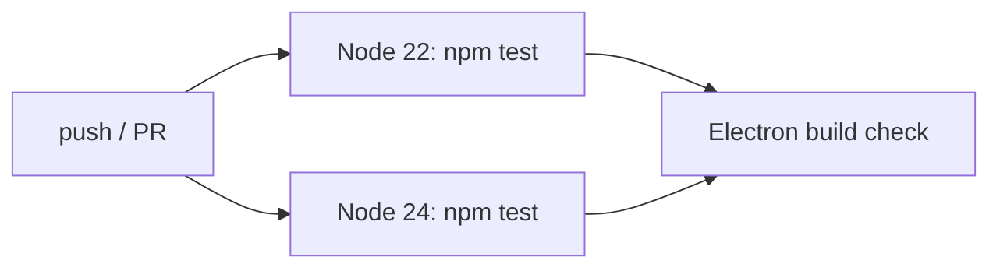
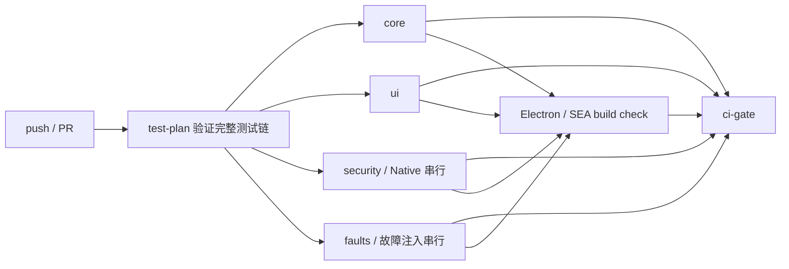

# CI 性能优化验收

## 1. 基线与提交

- 原始 `origin/main`：`cbcd6c21a147fb71946af61e2ea16a94973b0a9f`（`v0.26.0`）。
- 初始实现提交：`a8af49c`（在其之前另有审计提交 `ab40781`）。
- 分支：`codex/ci-performance-optimization`。
- PR：待推送后填写。
- 最新 PR CI：待运行后填写。

## 2. 变更文件

代码与测试基建：

- `.github/workflows/ci.yml`
- `.github/workflows/release-check.yml`
- `.github/workflows/release.yml`
- `.github/workflows/signpath-sign.yml`
- `package.json`
- `scripts/test-group-plan.mjs`
- `scripts/run-test-group.mjs`
- `tests/ci-test-plan.cjs`
- `tests/ci-workflow.cjs`

文档与约定：

- `AGENTS.md`
- `README.md`
- `docs/testing.md`
- `docs/ci-optimization-audit.md`
- `docs/ci-optimization-acceptance.md`

未修改产品依赖、Electron 版本、pi 版本、项目版本或 `package.json#engines.node`。

## 3. Node 版本

- CI、Release Check、Release 和 SignPath 均固定 Node `24.14.0`。
- 本地实测 `node --version` 为 `v24.14.0`，npm 为 `11.9.0`。
- Node 22 matrix 已删除。Node 22 不再通过持续集成验证。
- 产品 `engines.node` 保持 `>=22.19`：Electron、pdfjs 和开发依赖仍支持该下限；
  移除 CI 覆盖本身不构成提高产品最低版本的依据。

## 4. CI 结构

优化前：

优化后：

`test-plan` 从 `package.json#scripts.pretest` 与 `scripts.test` 动态生成 matrix。
workflow 不保存测试列表。未知新测试默认进入 `core`，不能因未更新分组而漏跑。

## 5. 覆盖一致性

基线 canonical 链有 143 个叶子套件。加入两个 CI 自检套件后共有 145 个：

| 组 | 叶子数 | 本地实测 |
|---|---:|---:|
| `core` | 75 | 298.134s，75/75 |
| `ui` | 23 | 104.543s，23/23 |
| `security` | 29 | 1800.240s，29/29 |
| `faults` | 18 | 986.034s，18/18 |

`node scripts/run-test-group.mjs --validate` 验证：

- 四组无重复。
- 四组并集恰好等于 canonical 链。
- 每个组内的相对顺序与 canonical 链一致。
- 每个 `node tests/*.cjs` 文件真实存在。

`tests/ci-test-plan.cjs` 校验测试清单与文件；`tests/ci-workflow.cjs` 校验 Node pin、
动态 matrix、构建依赖与最终 Gate。二者都通过 `pretest` 进入本地 `npm test`。

## 6. P33 安全完整性

P33 的 36 个 Session Change / Revert 叶子全部保留：

- `security` 包含 29 个 P33 Native、Writer、身份、权限、SACL/DACL、Store、Service、
  Recovery、Apply 和 Witness 套件。组内严格串行。
- `faults` 包含 7 个 P33 Faults / Recovery / Startup / Store 套件，并包含 Stop Barrier、
  Process、Supervisor 与 Runtime 恢复。组内严格串行。
- `session-revert-inplace` 保持文件对象身份和 DACL/ADS/EA/属性断言。
- 本机缺少 `SeSecurityPrivilege` 时，SACL 相关断言明确报告为 skip，不能进入通过数。
- 没有删除断言、把失败改成 skip、扩大测试超时或关闭 Native 用例。

逐套件证据见 [CI 性能优化审计](ci-optimization-audit.md)。

## 7. 并行隔离

每个 matrix 项运行在独立 GitHub runner，拥有独立 PID、句柄、文件系统和端口空间。
作业内设置独立的 `TEMP`、`TMP`、`TMPDIR`、`PI_GUI_CI_TEMP` 和结果目录。
固定端口按组分配；随机端口测试继续使用 `listen(0)` / `HARNESS_PORT=0`。

同一 runner 内不并行执行测试。Writer、文件身份、SACL/DACL、句柄和故障注入保持在单一
串行安全组。测试不会关闭用户进程，也不会共享可变 Native 目标。

本地四组同机并发验证墙钟为 1801.446 秒，四组 runner 时间合计 3188.952 秒；
145/145 叶子成功，未观察到文件、端口、PID 或临时目录串扰。

## 8. 构建与发布门

- `build-check` 依赖完整测试 matrix；任一组失败时不会开始打包。
- 构建 job 固定 Node 24.14.0，继续执行 `build:app --rebuild`、`test:app`、`test:exe`。
- 最终 `ci-gate` 在 `always()` 下检查 `test-plan`、全部 test matrix 和 `build-check`
  的结果必须逐项等于 `success`；skipped、cancelled、failure 或未执行都不能假绿。
- Release 与 Release Check 继续串行执行完整 canonical 测试，不经过 CI 分组。

本地构建证据：

| Step | 结果 | 耗时 |
|---|---|---:|
| Generate test fixtures | 成功 | 0.755s |
| Electron + SEA build | 成功 | 12.395s |
| Packaged app | 26/26 | 12.040s |
| Single-file EXE | 49/49 | 11.544s |

Electron 44.4.3 ZIP 的 SHA-256
`790a355b684d5c7cc8dc3cdd8c4cca7c4b2d054685427c7554a956879a82e70b`
与 `node_modules/electron/checksums.json` 一致。因本机 GitHub TLS 暂时不可用，本地构建使用
该已校验缓存 ZIP；正式 CI 使用正常的下载与校验路径。

## 9. 性能和运行状态

基线：

- 最新 `main` CI：55分46秒。
- Node 24 `npm test`：46分14秒。
- Node 22 `npm test`：53分11秒。
- 两遍测试 runner 时间约 102分36秒。
- Electron job：1分45秒。
- Release 预检：63分43秒。

本机完整叶子基线：143/143，3167.994 秒（52分48秒）。

本机优化后：

- 四组墙钟：1801.446 秒（30分01秒）。
- 四组 runner 时间：3188.952 秒（53分09秒）。
- 墙钟节省：1366.548 秒（22分47秒，约 43.1%）。
- 加本地构建步骤后的串行展示时间：1838.180 秒（30分38秒）。
- runner 资源时间基本不变；优化主要缩短等待，不把降低并行度误报成减少计算量。

GitHub Actions 的正式作业状态、墙钟和 runner 时间待 PR 运行后填写。

## 10. 失败与跳过

本地：

- 145/145 个 canonical 叶子退出 0。
- 0 个叶子测试失败。
- 明确观察到 19 个断言级 skip：日志 symlink 1 个、SACL witness 8 个、
  in-place SACL 2 个、Object witness 8 个。skip 不计入通过分子或分母。

GitHub Actions 的失败、取消、跳过和真实分布待 PR 运行后填写。

## 11. 风险与限制

- Node 22 不再经过持续集成验证；若未来重新支持 Node 22 的运行保证，需要恢复该 matrix
  或提供独立兼容性验证。
- PR 的四个测试 job 各执行一次 `npm ci`，runner 计算资源会高于单 job；这是用资源换墙钟。
- 分组依赖 `package.json` 的 npm alias 展开规则；`--validate` 与 CI 自检会阻止遗漏，
  但新增特殊 shell 语法时仍应审查编排器。
- Release 与 Release Check 没有改成并行，以保留发布链的完整串行证据。
- GitHub 当前未配置 `main` 分支保护或 required checks（API 返回 `404 Branch not protected`）；
  最终 Gate 只保证本 workflow 的状态，不能替代仓库设置。
- 用户明确禁止使用子代理，因此本轮未执行独立 AI 审查；按照 `REVIEW.md`，高风险 CI
  变更仍需用户最终审批。

## 12. 回滚

1. 回退实现提交 `a8af49c`，保留审计文档 `ab40781` 可不影响产品。
2. 若需同时回退审计和验收记录，再回退 `ab40781` 及本文件所在提交。
3. 在分支上撤销 workflow 修改后重新运行 `npm test`，即可恢复 Node 22/24 双版本结构。
4. 不修改 Tag 或已发布 Release；不需要触碰用户安装的 pi-GUI。

## 13. 人工决策

状态：**等待 PR CI 完成和用户批准，禁止合并。**
