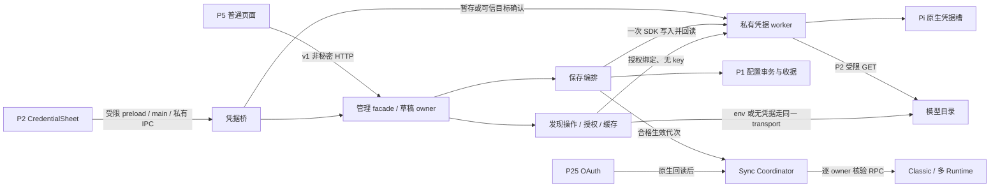

# 供应商管理 P3 技术实施方案

状态为待独立方案验收。基线为 `origin/main@c78dc8cf8bab9e238a1045df7a114d8b0195b571`，包含 [PR #60](https://github.com/HYJ1817/pi-gui/pull/60) 的 FIX-01 至 FIX-10。基线 [main CI](https://github.com/HYJ1817/pi-gui/actions/runs/42449139416) 为 push、第 1 次尝试、结论 success。本轮只交付规划文档。

**目标**　将 P0 HTTP 合同、P1 配置仓储和 Pi 原生 SDK、P2 私有输入面和受限网络接成三条可独立验收的生产链。保留 JavaScript ESM、Electron 私有父子 IPC、Node worker 与 Pi stdio RPC。P4 独立开发，P5 才进行界面接线。

## 1. 当前源码审计

| 核查项 | 基线事实及实施影响 |
| --- | --- |
| 1. 配置原子性 | P1 共享写锁对合作 GUI 进程串行，锁内恢复、重读、CAS、无损合并。受保护的 before/after 副本与 journal 先就绪，再逐文件安装 `models.json` 和 GUI metadata。每次替换校验目录身份、摘要和文件证据，恢复只接受匹配的 before/after，外部冲突停写。GUI 读取避开事务中间态。其他进程可观察到两次替换之间的状态，SDK 写入也不在事务内。Windows 跳过目录 fsync，不能承诺突然断电后两文件同时持久。 [仓储](../server/provider-config-store.js#L159) · [恢复与事务](../server/provider-config-store.js#L284) |
| 2. 暂存和提交关联 | P2 `prepare` 绑定草稿及连接代次，受限窗 nonce 和父子进程 epoch 防重放。P1 worker 按草稿保存内存项，set 有随机 `stagedRevision`，clear 尚无独立代次。HTTP commit 已校验 `apply-staged/clear-native` 的形状，目前明确返回 unsupported。草稿过期清理只删除管理 Map，`close-draft` 没有普通页面生产调用。P3 必须绑定精确 worker 代次和操作种类，而非仅按 draftId 取最后一次输入。 [Electron 控制器](../electron/provider-credentials.cjs#L247) · [桥](../server/provider-credential-bridge.js#L70) · [worker](../server/provider-credentials.js#L153) · [管理提交](../server/provider-management.js#L135) |
| 3. 原生保存和回读 | SDK 封装公开根 export，按 launch identity 绑定 Pi 1.5.0。worker 用公开 `readStoredCredential`、`listCredentials` 和文件身份前后核对，默认 `getAuth` 不参与回读。set 私下比较已编码存盘值的 literal-only 解码与暂存原文，clear 确认目标槽不存在。SDK availability 抛错仍需回读。普通 `readback` 是 `inspect` 别名，只有存在、类型和不透明版本，无法在 worker 丢失后确认同一把 key。当前 `authorizeStorage` 默认 false 且装配未注入，`probe` 只返回常量。 [装配](../server.js#L494) · [SDK 门槛](../server/provider-credential-sdk.js#L94) · [原生写后回读](../server/provider-credentials.js#L196) |
| 4. 部分成功和重传 | P1 持久收据按 `requestId+fingerprint` 去重，锁内先查收据，再校验当前 revision 和执行变更，保留最近 128 条。现有严格收据只接受配置已保存、凭据未操作、同步 pending。revision 使用进程随机 HMAC，重启后旧收据可重放，旧 revision 不能继续编辑。需增加独立的非秘密阶段证据与启动恢复，不能用原 P1 收据推断原生写入。 [收据校验](../server/provider-config-store.js#L58) · [revision](../server/provider-config-store.js#L169) · [事务重传](../server/provider-config-store.js#L341) |
| 5. 授权失效 | P2 consent 为内存 Map，15 分钟 TTL 和 AbortSignal，具有 revoke/revokeDraft/revokeDraftConnection/dispose。桥在成功替换/清除后撤销旧授权，草稿更新、管理路由、worker 换代和外部观察到的凭据变化尚未统一接线。记忆记录当前仅内存，显式 revoke 仍可能被 matchRemembered 重新匹配。空槽授权目前还可能带 inspect revision，违反 none 的无代次语义。 [授权存储](../server/provider-discovery-consent.js#L22) · [桥签发](../server/provider-credential-bridge.js#L196) · [草稿](../server/provider-management.js#L97) |
| 6. 缓存与发现 | P0 的 authorize/revoke/discover/test/operation/cancel/sync 客户端和校验存在，服务端目前只执行 snapshot/drafts/commit。P2 transport 没有缓存或 HTTP 接线，worker 没有 `discover` 方法。旧 fetchModels 允许 env 引用并按旧规则联网，不能替代 P2 transport。 [HTTP facade](../server/provider-management.js#L150) · [公开客户端](../public/api.js#L275) · [旧发现](../server/providers.js#L204) · [P2 transport](../server/provider-network.js#L352) |
| 7. 保留上下文刷新 | 本机已安装 Pi `@earendil-works/pi-coding-agent@1.5.0` 的公开 stdio RPC 命令和处理器有 `get_state/get_available_models/get_available_thinking_levels/switch_session`，缺少专用的配置热刷新。前两项是读取当前快照。进程内 `ModelRuntime` 更新方法和扩展 context 的 reload 无法从公开 RPC 调用。相同文件的 `switch_session` 会销毁并重建会话服务。Pi 恢复可能改选模型，未持久化的树叶选择也可能丢失。具体证据见 §5。 |
| 8. 延后生效 | 当前 OAuth 装配先 `closeAll()`，再由 P25 同步器仅按 cwd/bridgeRun 做 Classic 重启与回读。它不够证明会话身份和模型档位保持。旧供应商面板的 `reloadPi` 还会清线程。P3 改成单个 coordinator 跟踪每个 runtime，活跃进程保持现状，在经证明的安全生命周期边界采纳。 [装配](../server.js#L938) · [Classic 同步](../server/provider-auth-runtime.js#L4) · [旧 UI](../public/providers.js#L638) |
| 9. 新旧运行版本 | Registry 已持有 backendInstance、workspaceEpoch、runtimeId/generation、sessionId、可信 locator 和会话文件身份。独立 Runtime 与 Classic 分别 launch。当前没有每次启动所载入的配置/认证版本，也没有逐运行时 sync 状态。GUI 模型投影可合并最新磁盘覆盖，不能替代原生回读。 [Registry owner](../server/runtime-registry.js#L63) · [绑定与启动](../server/runtime-registry.js#L182) · [Adapter](../server/session-runtime.js#L70) · [模型清洗](../server/provider-auth-sdk.js#L338) |
| 10. P4/P5 合同 | 保留 P0 v1 输入、fixture、状态闭集。读取本地未合并 P4 `44a76d2` 仅作差异核查，其 discovery controller 从 POST 直接读列表，尚未轮询 202 operation；草稿同步和真实取消也要在 P5 对接。P3 以 main 的合同和真实 HTTP fixture 验收。 [合同](provider-management-frontend-contract.md) · [P0 校验](../public/provider-management/contract.js#L153) · [fixture](../tests/fixtures/provider-management-scenarios.json) |

两个 feature flag 仍取显式环境值，默认关闭。管理路由在 token、Host、Origin 后进入应用级分支，OAuth 分发仍可能落到旧 owner 检查后，C 按精确前缀调整并补权限回归。现有 [OAuth 合同](provider-auth.md) 的授权交互、流程单飞和进度仍由 P25 持有。[路由](../server/router.js#L170) · [开关装配](../server.js#L494)

## 2. 目标架构与数据所有者



| 状态 | 权威 owner 和生命周期 |
| --- | --- |
| 持久配置 | P1 的 `models.json` 和 `DATA_DIR/provider-management.json`。旧 provider/模型 ID、无关字段及未知扩展原样保留。 |
| 编辑、授权、暂存 | 管理模块拥有 15 分钟草稿和 `draftRevision/connectionRevision`，Electron main 持有开窗代次，桥拥有 nonce，worker 持有绑定到代次的 secret。consent store 拥有授权，TTL 内仍须匹配 backend/worker/launch。 |
| 提交与恢复 | A 的受保护非秘密阶段记录关联现有 P1 收据。只有 Pi SDK 管理原生凭据；阶段记录只记事实、版本和恢复门。 |
| 发现与测试 | B 持有 operation、AbortController 和 60 秒缓存。worker 内只在已授权调用期间取原生 key 并发送。 |
| 运行生效 | C 持有目标配置代次与每个 live owner 的已验证代次。运行时模型、思考档位、native session 仍以 Pi RPC 为准。 |

| 阶段交接 | 拟增加的后端内部接口 |
| --- | --- |
| 草稿与凭据桥 → A/B | `reserveStage(draftBinding, kind)` 返回私有代次与占位，`closeDraft(draftId, draftRevision)` 与 `invalidateConnection(draftId, connectionRevision)` 切断旧授权和暂存。不存在的槽位保持明确 unknown/absent 区别。 |
| A → P1/worker | P1 增加锁内 `lookupReceipt(requestId, fingerprint)` 和受租约保护的事务入口。原生 `persistNative/clearNative` 增加精确 stage/worker 见证。终态只返回本机已确认、明确失败或未知及固定原因。 |
| B → worker/transport | 私有 `discover(binding, grantSnapshot, operationId, deadline)` 和 `cancelDiscovery(operationId)`。回包仅规范化模型、事实、闭集状态和终止确认。主进程内 env/none 调用同一 transport。 |
| A/B/P25 → C | `recordDesired(confirmedChange)` 接收已确认阶段和配置见证，`invalidate(providerId, cause)` 撤销受阻的旧同步资格。C 的 `captureStart(owner, launchEvidence)` / `observeReady(owner, launchEvidence)` 由真正的 runtime 生命周期调用。 |

## 3. A 凭据与保存的生命周期

### 私有资格、暂存和取消

1. 将 SDK 根 export 加载和安全方法探测变成真实资格。区分 `rawKeyInput/keyStaging`、只读存量能力及 `nativeCredentialPersistence`。独立检查真实直属 child、正常沙箱、主窗/frame、固定协议、维护互斥及 launch identity。可信 main 就绪后主动握手，换 child 重新握手，避免页面因首次快照禁用而永远不能启动握手。共享 HTTP 快照无法证明请求来自可信窗口时，桌面专用能力保守关闭。P5 从现有可信 preload `status` 的安全能力投影和后端资格取得桌面能力。浏览器自报标记不得作为写入或授权依据。
2. 实现 `authorizeStorage` 的只读资格检查。验证 `MODELS_JSON` 对应 agentDir 和 authPath、路径组件身份、无链接/reparse、现存文件类型及硬链接数。POSIX 核对 UID/安全权限及父目录，Windows 核对受保护 DACL、允许主体和不存在文件时的继承资格。禁止自动改原有 ACL 或创建空 auth 文件作为探测。资格不明保持关闭。SDK 调用前重验路径、身份、维护与预期 native revision，使用 worker 的私有快照确认结果。Pi 自身文件锁没有条件删除/更新，停同 provider 外部认证并在受限窗说明风险；检查后与 SDK 落盘之间仍可能被外部进程改变。
3. 给 set 和 clear 都分配私有 `stageGeneration`。桥只记录经过确认的 `{draftId,providerId,connectionRevision,stageGeneration,kind,workerEpoch,expires}`，连同规范化目标、launch identity 和私有的 expected native revision 由 worker 核验。用户应用前的候选仅在 worker 内，只有当前可信 flow/nonce 校验及按草稿序列化通过后才替换有效暂存。取消或迟到丢弃该候选，保留上一有效暂存。桥须修复 stage/clear 在 SDK await 后的确认缺口。模型和排序编辑只增 draftRevision，既有合格暂存保持；prepare 的未完成输入 flow 仍须核对发起时草稿版本。
4. 主表单关闭、过期、目标/API/认证源改变、worker/backend/安装身份变化时，共用 `closeDraft` 或 `invalidateConnection` 回收 flow、取消发现并销毁对应暂存。保存接受后冻结草稿。关闭输入窗只撤销对应输入操作，不能替代关闭表单。HTTP commit 只收原合同非秘密字段，依照桥的服务端批准选择准确代次，无匹配批准即拒绝。

```text
none → editing → staged | clear-staged → persisting → saved | cleared
editing cancel → 上一有效暂存或 none
staged / clear-staged → expired | 目标或所有者失效 → 重新输入或确认
persisting → saved-credential-error | credential-unconfirmed
saved / cleared → 独立 sync.pending → applied | error
```

### 可恢复的配置优先提交

- 新建 `server/provider-management-commit.js` 编排，配置 apply 继续走 P1。跨 Endpoint/API 的既有认证或未知认证一律走无凭据新 ID 复制，并复查注册目标和 native 槽。内置 provider 的真实目标由已验证 SDK 和可信有效配置确定，草稿/静态目录不能替代。仅在目标、原生方法和槽位均可证明时给内置 set/clear 放行，配置 apply 只改可编辑覆盖和 GUI 偏好。原生清除仅删 Pi 目标槽，保留 env 与配置引用。删除/停用服务也不隐式 logout。
- **复用现有锁路径**，将同步锁的 claim/release 抽成受控租约，令配置及收据事务可在已持有同一租约时运行。租约保护 GUI 提交期间的配置、凭据与阶段记录更新。进程内在任何 await 前保留准入，统一拦截 P3/旧配置写入、同槽 OAuth、输入替换及更新/安装/受控 CLI 的冲突动作；OAuth 使用相同 mutation admission。读回和 native 调用有硬超时，租约必须释放，不能以正在等待 SDK 无限占锁。合作 GUI 使用同一模型配置锁，外部 Pi 或手工编辑不遵守此锁。
- 保留 P1 严格 metadata v1 及其收据形状。新增受保护的私有 `models.json.pi-gui-operations.json`，与 P1 锁同作用域，绑定相同权威配置对。复用 P1 排他临时文件、权限检查、flush、身份复核、rename 和可恢复锁原语。该文件只存 `requestId`、规范非秘密请求 fingerprint、providerId、动作、阶段、闭集结果、目标生效代次及非秘密文件身份见证。拒绝 schema、owner、权限或配置对不匹配。未决记录不得因历史收据满额被驱逐；容量不足先拒绝新写入。它与 P1 两文件分别落盘，通过以下顺序恢复：
  1. 查询 P1 收据和 P3 记录，再看草稿或 revision。相同 ID、同请求在途共享结果，内容或路由不同返回 `request_id_conflict`。检查当前草稿、有效目标、暂存代次与资格。先持久化 `prepared`，再调用 `store.transact`。P1 收据为配置已提交的证据。修改 P1 的收据裁剪，锁内从 P3 未决记录重建精确 `requestId+fingerprint` 的保护集合。保护范围从 prepared 开始，到包含配置事实的 P3 终态持久化后结束，覆盖重启及其他服务的写入。达到 128 条上限时只驱逐未保护的历史条目，无法为新收据腾出位置则在发布 journal 前返回 `config_busy`。不会扩大 P1 v1 文件形状。[当前收据裁剪](../server/provider-config-store.js#L341)
  2. 确认配置事务、当前配置见证和暂存仍有效后，先持久化 `dispatching`，再派发一次 `persistNative/clearNative`。内部调用增加预期 worker epoch、精确 stageGeneration/kind 及提交占位，密钥留在 worker。固定先保存配置的规则不能被 native 重试绕过。
  3. worker 使用原生 SDK 写入、重新安全回读。literal 编码沿用 `$$/$!`，以等值或明确空槽作本地确认。先持久化终态，再返回 HTTP 与发布 sync eligibility。P1 记录中的原始 revision 属于签发进程，重传返回原收据事实，下一次写前刷新快照。
  4. 若进程在 `prepared` 阶段退出，先恢复 P1 journal，再查精确收据。无收据且能证明配置未提交则无 native 副作用；有收据则配置已保存、旧暂存已丢失。若无法证明配置阶段，返回配置待恢复并停写。遇 `dispatching`、worker 超时或 SDK 结果不明，默认 `credential-unconfirmed`，只做安全回读，不自动重放 native 写入。

SDK 超时释放短期租约后，持久未决标记仍阻断同一 auth authority/槽位的 P3 写入、OAuth 及旧配置改绑。新 requestId 和二次确认也不能越过。将写入结果与停止证据分别处理。

- 每次派发使用绑定 worker epoch 的私有 attemptId 与 AbortController。超时发出对应取消并封禁该 attempt 的重新派发。仅同一 worker 在 SDK 写调用及其清理已经结束、并移除该 attempt 的所有待执行写入后，才能返回匹配的 `native-quiesced`。其后在租约内重新检查路径与 SDK 槽的稳定安全快照，才能持久化解除写入隔离。即使可以解除，缺少等值见证的旧请求仍是 `credential-unconfirmed`。
- 当前 worker 超时会先结束等待，再异步 `terminate()`，`persist` 的 signal 也未绑定请求取消。新实现须区分这些信号。超时、abort 已发送、调用 `terminate()`、重启或读到相同值都不能单独充当停止证明。失去匹配确认时保持持久隔离，并由维护者走停写恢复。停写恢复须停止该存储权威下的 Pi/GUI 写入者，验证旧 worker/进程已结束和 SDK 存储无活跃锁，再由只读资格检查重验路径、权限与槽状态。仅显式记录恢复结论才能解除隔离，无法确认时继续隔离。禁止自动删除 SDK 锁或自动重放旧请求。[适配器超时](../server/provider-credential-sdk.js#L39) · [原生写入](../server/provider-credentials.js#L196)

| 观测到的事实 | 用户可见结果及恢复 |
| --- | --- |
| 冲突或暂存无效，配置未提交 | `saved` 不成立，返回闭集冲突或禁用。重读，必要时重新打开受限输入窗。 |
| P1 journal 已发布但两文件未确认 | `config_recovery_required`。先按 P1 恢复，外部冲突停写。恢复前禁止 native 阶段。 |
| 配置已保存，确定未派发或 native 确定失败 | `saved:true, credentialSaved:false, credentialState:'saved-credential-error'`。保留配置与草稿；通过最新 revision、同目标安全回读、新 requestId 和新的私有批准发起重试。复用已有提交逻辑，未改变的 models 字节不重复写；旧请求只回收据。 |
| 配置已保存，native 写入不确定 | `saved:true, credentialSaved:null, credentialState:'credential-unconfirmed'`。重启后即使看到存在的 API key，也不能证明与原输入相同；clear 空槽只能说明当前事实。保持该服务同步受阻，需明确重新批准或保留当前已核实凭据。禁止用 hash、备份 token 或 SDK 异常内容持久化证人。 |
| native 回读成功，阶段记录写失败 | 只报告已持久化的证据。同一进程有等值见证时仅重试终态收据写；进程丢失后按不确定处理。不得再 login/logout。 |
| 配置与 native 已确认，SDK availability 或 Runtime 失败 | `saved:true, credentialSaved:true`，`saved/cleared`，sync pending/error。重试只走 `/sync`，重新读取有效模型和思考档位。 |
| 终态已持久化，HTTP 连接丢失 | 同 ID、同请求读取终态。过了收据保留窗口后先刷新快照、对比持久事实，绝不自动以新 ID 代重放。 |

不确定或失败的服务必须隔离于其新版本的同步资格。管理快照可单独展示已持久配置；新 GUI Runtime 读到磁盘新配置后不能假称整个版本已应用。对受阻服务的主动选择或发送使用定向准入和稳定原因，其他服务/会话继续运行。外部 Pi 可直接读已落盘配置，防旧凭据跨目标的写前校验必须独立成立。

## 4. B 自动发现、缓存和连接测试

### 授权与网络执行

1. 从服务端草稿重算 provider、连接代次、完整目标（scheme、host、port、basePath）、API、受限候选、来源、私有凭据代次及 backend/worker/launch identity。收到 POST 时检查最新 draftRevision。执行与收件用连接身份和凭据代次，模型编辑保留有效授权。已保存配置、同源 token、客户端 fingerprint 和 `force` 各自不能充当授权。
2. 原生 `staged/stored` 只通过可信 CredentialSheet 确认。HTTP authorize 返回 `requiresDesktopConfirmation:true` 时无 consentId、零网络。stored 只支持经单次公开 SDK 快照证明的 literal API key，拒 command、未转义 env、opaque headers、OAuth 或来源不明。staged 使用确切 worker 代次。none 的代次缺省或 null，显式授权且实际地址均为回环时才允许无秘密 HTTP。`localhost` 解析到公网直接拒绝。
3. env 只由服务器从可信绑定解析。首版接受审核过的目录 preset 精确目标和指定引用，或同一策略证明的已保存服务。现有 `credentialAction.env.reference` 写配置合同保留。草稿没有 env 引用字段，未保存自定义 env 及不可证明的旧引用降级为配置/手动模式。`piRegistrationReference` 只是无密钥回环注册占位。页面不能用任意变量名取 GUI token、系统凭据或将其发往自填目标。P3/P5 禁止回退到旧 `/api/providers/models`，旧手动路由的环境变量限制单列安全决策。
4. 只在规范 basePath 的段边界内拼接受支持的目录后缀，拒歧义编码及上级回退。现有 helper 对 `/tenant-a/v1` 可产生 `/tenant-a/models`、`/models`、`/v1/models`，超出精确目标。需独立目录地址的服务先降级。未来固定映射须显示并明确授权。旧兼容 helper 保持语义。候选列表服务端生成并复制，最多 8 项，API 取规范 connection，keyed grant 拒空代次。
5. 让原生 key 留在 worker 中，调用唯一的 P2 transport。将现有 eval worker 整理为真实私有模块，源码直接运行入口，既有 esbuild 编译 CJS worker 载荷，Electron 和 SEA 随私有资源携带，通过 `readAsset` 读取。worker 接授权快照、操作 ID 和私有绑定，不接页面任意 URL。取消帧绕过 native 写队列，终止传输并清理后确认，发现超时不默认杀掉正在执行其他原生写入的 worker。排队、凭据解析、DNS、候选和响应共用 30 秒预算。DNS 后、每次发包前和返回前复核授权及私有快照证据，观察到凭据变化就中止，绝不调默认 `getAuth` 换成新值。 [构建](../scripts/build-exe.mjs#L90) · [私有资源](../lib/assets.js#L74)
6. 记忆只存非秘密描述和策略版本。可持久化无凭据目标的批准，重开重算绑定并确认仍无凭据，再签发新 consentId。stored/env 的同实例重开也须证明同来源同代次。worker/backend 重启时旧 HMAC 或凭据存在性不足以证明连续性，重新确认。staged 永不记忆。显式撤销同时删除精确目标的记忆记录并停止匹配作业；普通过期和关闭只取消活跃授权。

### 操作状态与缓存提交点

```text
unapproved → authorized-idle → debouncing(600ms) → refreshing → ready | empty | error-stale
operation  pending → running → success | failed | cancelled
授权过期、关闭、换目标 → 中止排队与传输 → 等清理确认后 cancelled
```

- `discover/test` POST 202 返回 `operationId`。GET 只读。拟限制每服务单飞、全局 8 个在途操作、128 个终态且保留 15 分钟。相同 requestId 和规范请求返回同一操作，fingerprint 包含路由和相应 operationId，复用异内容返回 409。先同步占位再异步执行。较新请求实停旧请求。活跃项不能被 TTL/LRU 驱逐，已经成功的终态不能改写成 cancelled。
- 后端内存缓存 60 秒 fresh，按 `providerId+完整目标+API+策略版本+credentialSource+privateGeneration+launchIdentity+approvalEpoch` 分区，拟上限 64 条且合计 8 MiB。显式 revoke 失效匹配缓存和旧结果，并提升批准代次。所有缓存出口（包括草稿的 `cachedModels` 和 operation 轮询）须核对当前授权与批准代次。无授权时编辑先呈现已配置/手工项，合法同绑定授权可呈现缓存。GET、草稿编辑和普通选择不触发网络。P5 在授权且凭据就绪时安排 600 ms debounce，fresh 命中无发包。手刷 `force:true` 只绕过 TTL 和防抖。连接测试走显式实时只读探测，不把缓存当新证据。
- 每次异步返回及发布和写 cache 前，核对 `operationId/dialogGeneration/requestSeq/connectionRevision/targetFingerprint/credentialGeneration`、当前草稿、授权、worker 和 launch。换目标、轮换、撤销、保存冻结和关闭会使旧结果不可采纳，已完成旧结果也不得再经轮询返回模型。旧 cache 仅限仍匹配的绑定作 stale 显示。结果只更新候选模型，失败、取消和空结果均保留选择、排序和手工模型。缓存和操作重启即丢。
- 补齐协议适配。现有 [协议 fixture](../tests/models-api.cjs#L89) 包含 OpenAI `object/created/owned_by`、Anthropic `type/created_at`、Google `models/` 前缀及生成方法。P2 会把部分合法条目丢弃并当空目录。按协议允许已验证的标量元数据参与形状校验，输出仍走模型字段白名单及秘密回显过滤。Google 沿用去前缀、去重和合格生成模型语义。分别处理有效空列表、合法但无适用模型、畸形或全部不安全，最后一类不得用空列表覆盖旧缓存。 [P2 投影](../server/provider-network.js#L260)

### 连接测试的证据

只执行同一受限目录 GET，不追加推理探活、认证端点或任意 HEAD。返回 `reachability/modelListAccess/credentialAccepted` 三值、`inferenceVerified:false`、固定 `evidence` 与 `checkedAt`。没有经验证的专有认证证据时 `credentialAccepted` 保持 null。

| 情况 | 事实及闭集反馈 |
| --- | --- |
| 2xx 有效列表，包括空列表 | true / true / null，`model-list` 证据。空列表为有效发现结果。 |
| 401 / 403 | true / false / null，分别提示认证请求未通过或权限拒绝，停止当前候选及自动尝试。 |
| 所有授权候选 404 | true / false / null，目录不存在。 |
| 429 | true / false / null，停止尝试。只从合法且有限的 `Retry-After` 投影可选 `retryAt`。 |
| 2xx 非 JSON、畸形、超限 | 有安全 HTTP 状态时 reachability=true，modelListAccess=false；否则 unknown。 |
| DNS/TLS/断连/超时 | 无 HTTP 证据时事实保持未知。仅回固定阶段和错误。 |
| 未授权、撤销、不支持 | 零网络，事实未知，返回 `invalid_target/policy_rejected/unsupported` 及固定原因。 |

## 5. C 配置应用与多 Runtime 同步

### Pi 1.5.0 的真实能力

本机只读检查安装包的 `dist/modes/rpc/rpc-types.d.ts`、`rpc-mode.js`、`core/model-runtime.js` 和会话恢复实现。对应上游固定提交 `f9a26365568127461c47a07a37dcb42c140a3ac5`。公开 wire 的 `get_available_models` 读取当前快照。扩展 context 的 reload 和进程内 SDK refresh 没有公开 RPC 对应命令。认证存储可在后续 credential lookup 检测到文件变化，但不能据此宣布活跃模型目录或档位已更新。[RPC 类型](https://raw.githubusercontent.com/earendil-works/pi/v1.5.0/packages/coding-agent/src/modes/rpc/rpc-types.ts) · [RPC 实现](https://github.com/earendil-works/pi/blob/f9a26365568127461c47a07a37dcb42c140a3ac5/packages/coding-agent/src/modes/rpc/rpc-mode.ts#L470) · [SDK refresh](https://github.com/earendil-works/pi/blob/f9a26365568127461c47a07a37dcb42c140a3ac5/packages/coding-agent/src/core/model-runtime.ts#L856)

同文件 `switch_session` 也会结束并重建会话服务。Pi 重开按磁盘内容恢复树叶，而一些分支导航只修改内存。模型不可用时 Pi 也可能选择其他模型或收敛档位。相同文件和 sessionId 不足以证明上下文保持。C 默认在新建、用户重开或恢复等正常生命周期点采用新配置，活跃或不能证明安全的会话保持 pending。不用 prompt 或扩展模拟 reload，不自动切模型、设置档位或调用全局 closeAll。[会话重建](https://github.com/earendil-works/pi/blob/f9a26365568127461c47a07a37dcb42c140a3ac5/packages/coding-agent/src/core/agent-session-runtime.ts#L167) · [树叶恢复](https://github.com/earendil-works/pi/blob/f9a26365568127461c47a07a37dcb42c140a3ac5/packages/coding-agent/src/core/session-manager.ts#L1104) · [模型与档位恢复](https://github.com/earendil-works/pi/blob/f9a26365568127461c47a07a37dcb42c140a3ac5/packages/coding-agent/src/core/sdk.ts#L209)

### 调度、版本和回读

- 持久化随机 `desiredGeneration` 代表已确认可生效的配置/认证版本。P1 revision 仍做 CAS，OAuth 单独变更可只提升 generation。P1 `syncRequired` 仅是脏提示，不能证明凭据已保存或全部已应用。不要通过清位制造用户编辑 revision。配置见证来自相同配置锁下的非秘密文件身份和当前配置对。外部变更或来源不明时重读，停止签发 applied。
- 逐实例核对。Classic 使用 workspace generation、cwd、bridgeInstance/run、native sessionId 和已验证 sessionFile。独立 Runtime 使用 Registry 完整 owner（backendInstance、workspaceEpoch、conversationId、runtimeId/generation、sessionId）和文件对象身份。补上实际启动的 Pi identity、版本及 agentDir 证据。每次等待前后复核。工作区 A→B→A、后端重启和旧运行代次不能继承过期结果。 [Classic owner](../server.js#L1040) · [Registry](../server/runtime-registry.js#L63) · [launch](../server/pi-launch.js#L198)
- 在实际 spawn/恢复入口捕获目标代次，ready 后回读。启动中途有新配置，旧启动不能标记为新版本。忙碌、后台 prompt、未排空停止、审批、候选任务、Planner、工具/受管进程、更新/安装/CLI 或文件变化均 pending。只复查目标，避免全局暂停。
- 自动逐个重开只作为资格分支。必须先证明目标空闲、无在途 RPC 或不可恢复内存状态、session 文件可信且持久化树叶与当前一致、模型及档位可保持，并通过独立验收。通过私有逐目标生命周期 gate 保留目标，`--session` 使用已证实存在的同一文件，禁止 `--continue` 和本次同步失败后的通用自动重启。既有 Registry `restart()` 会 close/resume 并发 runtime_closed，不能直接复用为后台同步。条件不足时保持 pending，正常生命周期生效仍是 C 的验收路径。 [Classic restart](../server/rpc-bridge.js#L904) · [Registry restart](../server/runtime-registry.js#L383)
- 只有同一目标的原生 `get_state/get_available_models/get_available_thinking_levels` 成功且形状可信，身份和版本见证相符，才记 applied。使用 private RPC 原始成功数据，不以 UI sanitize 后的空列表或叠加最新磁盘覆盖作证明。重开的现有会话还需比对 sessionId/file、必要的 get_tree leaf、模型与档位。Pi 自行回退时记 error 并提示用户选择。Classic ready 要避免 `applyProjectPreferences` 再选模型。 [RPC request](../server/rpc-bridge.js#L606) · [模型投影](../server/provider-auth-sdk.js#L338) · [项目偏好](../public/project-config.js#L70)
- 将配置变化分成原生目录变化、仅 GUI 投影变化和仅认证变化。原生目录变化要求稳定的 spawn→ready 配置/agentDir 证据，以及受影响模型 ID/字段的可观测预期差异或等价的正面加载证据。因认证未就绪导致模型缺失时保持未应用。仅 GUI 元数据变化可在既有 native 版本证据仍匹配时应用投影。仅认证变化要求确证的新实例、稳定的已回读凭据和配置证据、可用目录回读，结论是本机已采纳对应版本，远端认证与推理仍未知。只能观测到健康 RPC 或 PID 时保持 pending/error。
- 后端重启废弃旧 live owner，先恢复 A 未决阶段和持久目标代次，再按当前 Registry/Classic 重建 pending/readback。禁止为同步启动休眠会话。失败的重试只重新准入和回读。持久状态只记期望版本和固定原因，路径、session locator 和原始回包不进入公开结果。
- OAuth 登录/退出沿用 P25 worker/flow 和事后安全回读，区分已变更、无变化和未知。确认变更后走同一 coordinator，保留旧 `/api/provider-auth/sync` 形状及 `synced` 对已确认 applied 的映射。移除 provider 同步装配的 `closeAll`，维护专用停机行为独立保留。GET 不调度重启，事件和 POST 才调度。旧 provider 写入也登记已提交变更，旧面板换线留 P5。

```text
可生效版本 → 每目标 pending → syncing → applied
busy / no-session / unsafe-context → pending（等待安全生命周期）
readback_failed / state_changed → error（显式重试）
新版本或新 owner → 旧结果作废 → 对当前 owner 重排
```

模型选择的权威仍是 Pi。P5 两 picker 使用实际可用集合与 GUI enabled/selected 的交集并按 modelOrder 排序。null 继承，空数组为无候选。当前模型被移出候选时保留当前使用和实际 thinking。受阻凭据只做定向准入与提示，避免改变当前选择。

## 6. 安全不变量与 P2 回归门

| 威胁 | 阻断点与剩余边界 |
| --- | --- |
| 普通页面或旧客户端窃取/提交 key | 管理 HTTP 只接非秘密 DTO。输入只在专属安全 renderer、具名 IPC 和 worker 内短暂存在。schema、sender/frame/固定 URL、单飞、nonce、epoch、TTL、作用域和维护检查各自保留。禁止 GUI 将原文放入 HTTP/SSE、普通 DOM、缓存、argv/env、日志、诊断或阶段收据。不得序列化 SDK 异常。OS/同用户恶意程序和 JS 内存清零不在隔离承诺内。 |
| 新 Endpoint 继承旧凭据 | 规范目标和 API 都必须匹配；带任意已知/不明认证的旧服务只能无凭据复制到新 ID。新 ID 双重核验槽位。保持同槽 OAuth 二次确认，临时注册数据无密钥。外部原生写者仍有预查后的竞争窗口，权限和文件变更可观测时停写。 |
| 通过发现访问内网或跨租户路径 | 精确目标授权、公共 HTTPS/TLS、严格 in-base 候选、直连与 DNS 钉桩、校验全地址集和字面量、拒重定向、显式回环仅无密钥、限时和流式体积限制。禁止代理或缓存绕过。合法公网 IP 不能证明实际路由可达或可信，沿用 P2 已知地址策略。 |
| 并发、旧 worker 和重复提交 | 分别绑定草稿、连接、暂存代次、flow、操作、owner 和目标代次。锁内先对比收据，外部不确定写只回读。取消、身份变更和过期释放资源，旧结果不入缓存、状态或收据。 |
| 配置半写或运行实例误认 | P1 journal before/after 恢复，冲突停写。P3 的 native dispatch 独立持久标记。单目标核验和延后生效，错误不得清上下文或冒充 applied。 |

| P2 整改 | P3 必须复跑的相应证据 |
| --- | --- |
| FIX-01、03 | 字符串/对象以及新协议模型条目的哨兵过滤。凭据缺失、代次缺失/不符、旧 grant 绑定新 key、none 带凭据或代次时 requester 为零。 |
| FIX-02、06、07 | DNS 撤销、挂起、迟到 resolve/reject、DNS 消耗预算、拒绝重定向时关闭 socket、代理/池化不能绕过钉桩。worker 队列同样受 deadline，测试用实际注入的 requester 计数。 |
| FIX-04 | OAuth 同槽清除/替换须在受限窗二次确认。失败和重试保留原流程语义，成功后 nonce 一次性消费。 |
| FIX-05、09 | 握手、prepare、取消后立即重开、窗口销毁、超时和 backend 换代。旧 finally 不释放新占位，最多一个窗口，取消清理后端 flow。 |
| FIX-08 | 在途 revoke、关闭草稿、连接/凭据轮换、到期、dispose、响应结束竞态及独立新授权。迟到授权不生成记忆，旧结果不可读、不可写 cache。 |
| FIX-10 | IPv4/IPv6 保留段、映射、畸形、稀疏回包、混合 DNS 和字面量路径。继续断言拒发。 |

执行 [P2 验收](provider-management-p2-acceptance.md) 的原网络、SDK、桥接和真 Electron 用例，并在 P3 生产入口加跨边界用例。正常沙箱结果与无沙箱回退分别记录。秘密哨兵只来自 fixture。

## 7. 三个实施单元

P3-A 先冻结私有暂存/收据/同步资格接口。B 的 operation/cache/协议 fixture 和 C 的 coordinator/假 Runtime 测试可按该接口并行设计。生产接线按 **A → B → C 集成**，避免并发改同一 worker、facade 或 `server.js`。每单元可以独立提交、推送和验收，提交不等于打开开关或合并。新专项登记到现有 `package.json` canonical alias。测试实现先写失败复现，再修，记录通过、失败和环境跳过的实测数字。

### P3-A 凭据持久化、保存编排和恢复

**范围与交付**　对 set/replace/clear/cancel 开通受限链路，交付受保护收据、写入资格和无 native 的兼容提交。向 B 提供生命周期、精确暂存来源和私有代次核验。向 C 提供持久合格代次及受阻服务。依赖已合并 P0–P2 和临时权限 fixture，难度高，主要风险是原生无 CAS、跨文件恢复、并发写者与错误暴露。

**预计修改**　新增 `server/provider-management-commit.js`、`server/provider-operation-state.js`。修改 `server/provider-management.js`、`server/provider-config-store.js`、`server/provider-config-records.js`、`server/providers.js`、`server/provider-credential-bridge.js`、`server/provider-credential-sdk.js`、`server/provider-credentials.js`、`server/provider-auth.js`、`server.js`、`electron/provider-credentials.cjs`、`electron/main.cjs`。仅在最小 DTO/状态或关闭动作经核准后调整 `public/provider-management/contract.js`、`public/api.js` 与合同 fixture。

- [ ] 固定 §3 的收据版本、锁租约、可写资格和 stage 代次。不启动真实凭据输入，先在测试中证明配置对及旧收据兼容。实现资格检查、共享互斥、无权限降级和不暴露异常。
- [ ] 完成可信暂存提升、准确消费、准备/派发/终态恢复和安全回读。检查关闭、轮换、超时、跨 endpoint、OAuth 确认和两个 backend 争用。
- [ ] 扩展 `tests/provider-config-store.cjs`、`tests/provider-credential-sdk.cjs`、`tests/provider-management-http.cjs`、`tests/provider-credential-desktop.cjs`、`tests/provider-credential-opening.cjs`。在 before journal、两次安装、配置落盘后派发前、派发后崩溃、已写但收据失败、响应丢失点故障注入。用超过 128 条无关请求测试跨重启保护收据及满额拒写。模拟 SDK 忽略 abort 或迟到提交，验证同槽新 ID、OAuth 和改绑均被隔离，错误 epoch 的停止确认无法解锁。并发同 ID 最多一次 native 调用，不确定时 native 重放数为 0。校验现存文件权限、继承、reparse、硬链接和其它 provider 凭据不受影响。
- [ ] 运行 `npm run test:provider-management`、`npm run test:provider-p2`、`npm run test:auth`、`node tests/server-security.cjs`，重建并验证正常沙箱与打包私桥。验收配置后凭据失败、已存待同步、能力关闭及部分事实投影，检查完整 canonical。独立安全复审通过方可交下一阶段。

**回滚**　先停新 native 写入并处理未决收据。代码可关闭开关，恢复 v1 读取兼容。旧程序忽略新增阶段文件前，必须先解决不确定记录并冻结并发写入。撤回配置只在当前文件身份和版本相符时使用 P1 受保护恢复。原生凭据由 Pi 重新确认或重新登录，禁止通过 GUI 回写 auth.json。

### P3-B 授权发现、连接测试及操作生命周期

**范围与交付**　启用现有 authorize/revoke/discover/test/operation/cancel 业务路径，提供真实取消、分区缓存和分级结果。只在授权范围内读取目录。依赖 A 的身份、暂存和草稿生命周期，纯 operation/缓存可用假端口并行。难度高，关键风险为 native key 越 worker、取消跨边界失效及旧目标泄漏。

**预计修改**　新增 `server/provider-management-discovery.js`。修改 `server/provider-management.js`、`server/provider-discovery-consent.js`、`server/provider-network.js`、`server/provider-credential-bridge.js`、`server/provider-credential-sdk.js`、`server/provider-credentials.js`、`server.js`、`scripts/build-exe.mjs`、`scripts/build-app.mjs`、`public/provider-management/contract.js` 及安全 DTO fixture。复用 `lib/models-api.js` 的协议 fixture/纯处理，任何提取必须保留旧兼容调用行为。

- [ ] 以 fixture 独立实现申请、operation ID、取消/撤销、60 秒缓存和三值连接测试。受理前验当前草稿版本，启动和发布复查连接身份。演练 600 ms 授权后自动路径使用同一 POST 合同。
- [ ] 接 worker 内的 staged/stored transport、env/none 受限来源与打包载荷。按 §4 关闭路径扩权，补协议形状及安全回显。识别并修正目前空槽授权带 revision 的路径。
- [ ] 扩展 `tests/provider-network-policy.cjs`、`tests/provider-management-http.cjs`、`tests/provider-credential-sdk.cjs`、`tests/models-api.cjs`，新增 `tests/provider-management-discovery.cjs`。用 DNS/socket/时间/IPC barrier 验证未授权及失效 requester=0，已发请求实停，迟到不入 cache，已关闭的旧 operation 不返模型。确认 60 秒边界、手刷、合法空目录/畸形以及所有 HTTP/网络分级，推理路径调用数为 0。用 OpenAI/Anthropic/Google fixture 确认合法条目、选择保留和敏感哨兵过滤。
- [ ] 运行 `npm run test:provider-p2`、`npm run test:provider-management`、`node tests/models-api.cjs`、`node tests/server-security.cjs`、`node tests/ci-test-plan.cjs`。验收源码、Electron 包和 SEA 私有 worker 加载，全部只用隔离目录与受控 fixture。

**回滚**　关闭发现能力时撤销、终止 operation，清空内存缓存，旧路由继续原有显式用途。已写配置、原生凭据和已选模型不由发现回滚修改。

### P3-C 多 Runtime 协调及集成验收

**范围与交付**　配置及 OAuth 共用 coordinator。Classic、多个 Runtime 各自跟踪安全生效并回读。对旧进程提供可解释的延后和显式重试。依赖 A 的合格代次、未决服务隔离及 B 的失效事件。难度高，关键风险是 owner 漂移、恢复丢失上下文、Pi 回退、错误的已应用状态。

**预计修改**　新增 `server/provider-config-sync.js`。修改 `server.js`、`server/provider-management.js`、`server/provider-operation-state.js`、`server/provider-auth.js`、`server/provider-auth-runtime.js`、`server/router.js`、`server/rpc-bridge.js`、`server/runtime-registry.js`、`server/session-runtime.js`。若需要区分 Classic bootstrap 的应用原因，仅对 `public/app.js` 和 `public/project-config.js` 增加兼容守卫。同步输出投影更新 `public/provider-management/contract.js` 和 P0 fixture。两 picker 的候选过滤和 P4 接线留 P5。

- [ ] 接真实 spawn/ready/lifecycle 及 per-owner 版本，发布逐实例 pending/syncing/applied/error，恢复后从当前权威对象重建。明确 no-project/no-session 与没有活跃目标的状态，不能用空集合证明所有 Runtime 已应用。
- [ ] 用同一 coordinator 替换 P25 的 provider closeAll 接线。守住 Classic/Runtime owner 和 mutation admission。实现普通安全生命周期的应用及显式同步重试。自动重开分支按 §5 资格独立验收，未达到门槛保持延后。
- [ ] 新增 `tests/provider-config-sync.cjs`，扩展 `tests/provider-auth-runtime.cjs`、`tests/provider-auth.cjs`、`tests/runtime-registry.cjs`、`tests/session-runtime.cjs`、`tests/runtime-models.cjs`、`tests/runtime-draft.cjs` 和 `tests/provider-management-http.cjs`。覆盖 Classic 与多 Runtime 忙闲交错、后台任务继续、A→B→A、失效 owner/epoch、错误 session 文件对象、无持久树叶、启动中换代、无可用模型/档位、旧回读迟到、OAuth 已存后报错、重启恢复。要求无全局 closeAll、无自动模型/档位命令、无草稿或上下文清理。
- [ ] 运行 `npm run test:auth`、`node tests/provider-auth-runtime.cjs`、`node tests/runtime-registry.cjs`、`node tests/session-runtime.cjs`、`node tests/runtime-models.cjs`、`npm run test:provider-management`、`npm run test:provider-p2`。完成完整 canonical、重建 `npm run build:app -- --rebuild` 与包内 smoke、正常沙箱隔离和独立功能/安全审查。

**回滚**　停止新调度，回收 per-owner 排队并保留已存配置/凭据和待同步标记。受阻结果按待同步呈现。任何会恢复旧的 provider 全局停机行为的二进制回退，须由维护者在可控停机窗口决定。

## 8. 给 P5 的冻结合同

以 [前端合同 v1](provider-management-frontend-contract.md)、[校验器](../public/provider-management/contract.js) 和 [现有 fixture](../tests/fixtures/provider-management-scenarios.json) 为准。保留旧 endpoint、方法、输入字段名、HTTP 形状和枚举。内部新增接口只服务阶段交接。实际冻结 DTO 通过与真实 router 共用的 fixture 验收，浏览器不依赖私有数据。

| 入口 | P3 定义和 P5 消费规则 |
| --- | --- |
| GET `/api/provider-management` | `Snapshot` 的原字段。capabilities 按 backend 真实资格和可信桌面能力决定，保持 Web、旧 SDK 与关闭开关的降级。GET 不发供应商请求。 `revision` 只用于当前 backend 的 CAS。 |
| POST `/drafts` | 原输入。返回权威 `draftId,draftRevision,connectionRevision,targetFingerprint,credentialState,consentState,cachedModels,sourceKind`。在已冻结的 fixture 位置返回非秘密 `credentialGeneration`，用于 UI 判旧，不是 worker UUID/HMAC。更新先用 `expectedDraftRevision`。 |
| POST `/discovery-authorizations` 与 `/revoke` | 原字段。返回 `consentId/expiresAt/targetSummary/requiresDesktopConfirmation`。HTTP 请求不产生原生密钥授权。桌面可信动作返回已签授权。撤销后旧 grant、记忆授权和作业不能复用。 |
| POST `/discover`、`/test` | HTTP 202 `{ok:true,operationId}`。提交最新草稿版本和原有 generation/seq/force。用户已选与模型 patch 只由草稿管理。 |
| GET `/operations/:id`，POST `/operations/:id/cancel` | `{ok:true,kind,state,revision,result?,error?}`。结果带绑定字段，模型遵守 fixture 的 `modelId/providerId/configSource/effectiveValues/editableOverrides`。过期/跨 owner 返回闭集错误。取消清理确认后终态 cancelled，GET 不调度。 |
| POST `/commit` | 保留原动作和 `credentialAction`。按 fixture 返回 `saved/credentialSaved/credentialState/revision/serviceId/operationId/sync`。配置成功而 native 失败时必须先读 `saved:true`，不能只判断 `ok`。请求失联以同 ID 和原请求重传查收据。 |
| POST `/sync` | 原 `{requestId,revision}`，返回 operationId 及 sync 摘要。按 `pending/syncing/applied/error` 提供逐实例项。拟冻结 `sync.items[]` 为 `{kind, runtimeId?, conversationId?, state, reason, desiredGeneration, appliedGeneration}`，仅含 GUI 不透明身份和闭集原因；客户端不提交路径或 owner 作为同步权限。 |
| 关闭草稿的最小增补 | 建议新增 `POST /drafts/:id/close {requestId,draftRevision}`。使用原应用级鉴权和当前草稿版本，返回 `{ok:true,closed:true}`，已关闭可幂等重传。避免已丢失 202 回执时只靠 operationId 取消。需独立方案验收确认；旧端仍用 revoke/cancel 和 TTL。该动作与既有私有 `close-draft` 进入同一后台清理，不扩大秘密 IPC。 |

保留已有 `invalid_request/config_conflict/draft_conflict/request_id_conflict/credential_conflict/credential_target_conflict/config_busy/unsupported/config_recovery_required` 和 400/409/422/423/503 语义。部分成功按现有 fixture 扩充 `native_write_failed/credential_unconfirmed` 固定文案并携带事实。其 HTTP 状态在 A 与合同 fixture 一起锁定，建议返回 200 阶段收据，配置前失败仍用原错误状态。运行错误只用固定安全码。目录失败区分 `http_401/http_403/http_404/http_429/timeout/invalid_target/policy_rejected/unsupported` 和 P2 受限网络错误，增补只限 operation DTO 白名单。状态收件先核对 operationId、dialogGeneration、requestSeq、connectionRevision、targetFingerprint、credentialGeneration。写入和同步成功不作认证或推理证明。

按独立 DTO 校验 commit 的部分失败状态。fixture 的 `saved-credential-error` 和 `credential-unconfirmed` 与输入窗凭据子状态枚举分开，不直接 cast worker 回包。

## 9. 决策与实施摘要

| 待独立验收的决定 | 建议与实施门槛 |
| --- | --- |
| native 写入资格及无 CAS 风险 | A 可以从离线测试开始。真实写能力开放前须证明 SDK 公开路径、Windows DACL/POSIX 权限、准确目标及同槽确认。接受外部进程无 CAS 的剩余窗口，文档和确认窗明确说明。失败时能力关闭。 |
| v1 的最小增补 | 接受独立非秘密阶段文件，维持 P1 metadata v1。批准 draft close、逐实例 sync 投影及新增固定状态。延续当前请求形状，P3 不加可由普通 HTTP 提交任意 env 的字段。 |
| 记忆与远端能力 | 默认键控授权跨重启重确认。未证明自定义 env、OAuth 目录或独立目录地址时，提供手动模型与清楚的 unsupported。旧手动 env 路由是否加同级限制单列，不能作为 P3 回退。 |
| Runtime 延后与自动重开 | 采用安全生命周期生效为默认。无透明刷新证明不是 A/B 开工阻断。自动重开需独立资格，未通过不影响逐实例 pending 和可解释的重试。 |
| P5 工作 | 将 P4 的 fixture controller 换成真实 202 轮询/取消和 600 ms debounce；对接草稿版本、关闭、可信输入窗、部分成功、重试和同步状态；旧设置页迁移，两 picker 做 GUI 投影；验收焦点/IME、窄窗、主题、Browser 遮挡及打包接线。最多三项的首次推荐只在新建、可信结果且未 touched 时由 UI 执行。 |

建议 **三个阶段**。A 由 Codex 主做，独立安全审查者复核凭据和文件边界。B 的 worker、授权和 transport 由 Codex 主做，DeepSeek 可独立做纯 DTO fixture、缓存状态与受控协议回归。C 由 Codex 或熟悉本仓库 Runtime 的工程 agent 主做，另由独立审查者验证故障注入。P5 由 Codex 接线、DeepSeek 修订 P4 界面状态。三个单元的生产接线和交付验收依次进行。

**第一步**　在新实施分支编写 A 的故障注入测试，锁住同请求最多一次 native 派发、P1 配置完成后的凭据失败及 worker 换代。先完成只读资格与保存编排，再打开测试装配。当前没有阻断 A 离线开工的问题。正式开发须等本方案独立验收及实施授权。

## 10. 本次规划验证

- 基线 main CI 8/8 通过。当前 `node tests/ci-test-plan.cjs` 复核 239 条 canonical 命令和五组精确覆盖。
- 本地 `node --test tests/provider-network-policy.cjs tests/provider-credential-opening.cjs tests/provider-credential-sdk.cjs` 48/48、零跳过，`node tests/provider-auth-runtime.cjs` 36/36。均为当前实现的离线基线，使用假 SDK、假 Pi、临时目录和受控网络 fixture。
- 源码审计与读者复核已完成。此文档尚待独立方案验收。本轮是纯文档变更，完整本地 `npm test`、构建、真实凭据读写和供应商调用均未运行。
- Claude Code 对 P3-A 持久派发和恢复的独立复核指出两项缺口。计划补充了未决 P1 收据保护，以及按 attempt 和 worker 证明写入停止的隔离解除判据。对这两项的独立增量复核通过，结论限于设计。发现和 Runtime 链仍待独立方案验收。
