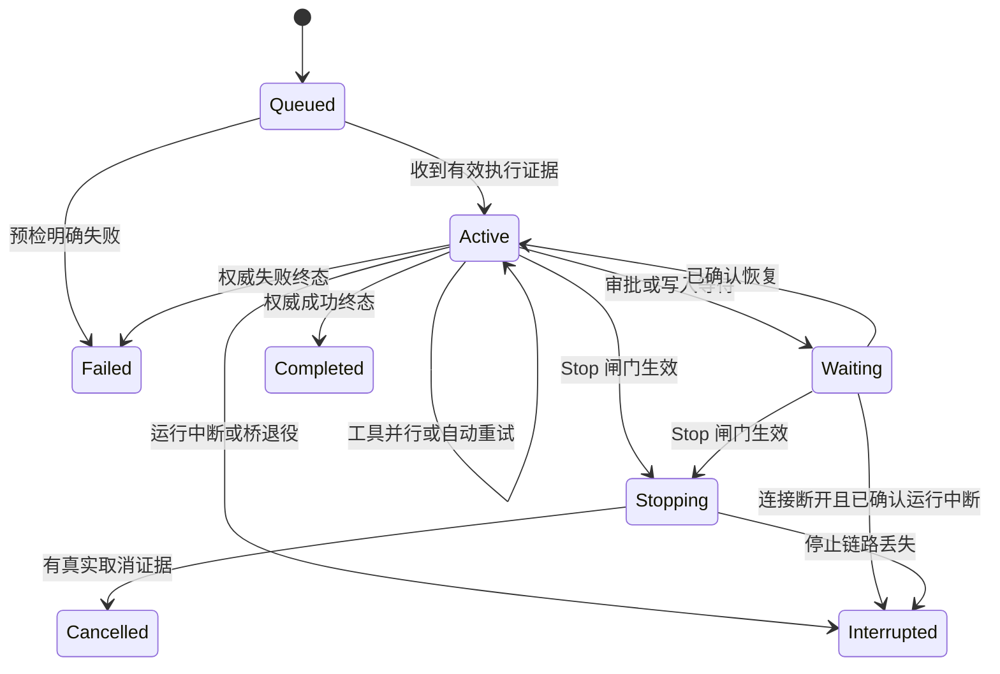

# P5-0 统一时间线交互规范

适用于 Classic 与 Runtime 的会话阅读区。壳层、项目/会话导航、被钉住的 Composer、审批与右栏保留原入口。布局取自 [视频时间轴](session-ux-p5-reference-analysis.md)，实体、归属和可用数据见 [架构契约](session-ux-p5-architecture.md)。

## 页面和单轮结构

```text
+------------------+----------------------------------------+-----------------+
| 项目与会话导航   | 会话标题 / 原有会话操作                 | 现有工作面板    |
|                  +----------------------------------------+ （按需存在）    |
| 会话 A           | 阅读区                               ^ |                 |
| 会话 B [已完成]  | ├── 旧任务  [用户原文简览]             | |                 |
|                  | │   ├── 计划   3/3                 >  | |                 |
|                  | │   ├── 执行活动 · 9 项 · 45s       >  | |                 |
|                  | │   ├── 最终回答（既有 Markdown）     | |                 |
|                  | │   └── 已完成   [用量与耗时]         | |                 |
|                  | └── 当前任务                          | |                 |
|                  |     ├── 用户任务   [附件] [Show more] | |                 |
|                  |     ├── 计划                         v | |                 |
|                  |     │   (✓) 核对状态                   | |                 |
|                  |     │   (●) 审查事件归属               | |                 |
|                  |     │   (○) 核对历史                   | |                 |
|                  |     ├── 执行活动                      | |                 |
|                  |     │   v  读取 state.js · 35m 25s    | |                 |
|                  |     │   ├── > 执行 git status         | |                 |
|                  |     │   ├── v 读取 state.js  40–149    | |                 |
|                  |     │   │     参数 / 已返回的输出      | |                 |
|                  |     │   └── > 修改 contract.js +6 −3  | |                 |
|                  |     ├── 补充输入、过程发言与思考锚点   | |                 |
|                  |     └── 最终回答或未完成答复（有则显示）v |                 |
|                  +----------------------------------------+                 |
|                  | 原有运行提示 / 回到底部 / Composer     |                 |
+------------------+----------------------------------------+-----------------+
```

活动组收起时，过程发言和已完成思考显示在其后的小型 disclosure 入口。展开组后，它们在组外的过程内容区按源序排列，保留可定位的独立消息；活动列表只收工具/结构化活动，过程区保留真实相对序号供定位。活跃 thinking 继续使用原组件和宿主，必要时独立展现在既有流尾位置。用户可以在主卡和后续补充输入之间区分作者、提交时序和执行归属；补充输入显示一次，不当作新任务卡。上图示例数据用于规格说明。

## 用户任务

- 原始任务作为一条用户消息呈现在本轮顶端，复用现有 `userBody` 的 Markdown、图片缩略图、文件卡和消息动作。Classic 直接组合现有渲染；Runtime 接入与授权消息数据对应的内容引用。在验证附件可用前沿用旧视图或提示「附件暂不可恢复」。
- 默认在真实溢出时截断正文至约 6 行。长任务正文用现有排版和溢出测量，图片或文件条在正文截断之外，文件正文沿用既有折叠。仅图片的消息仍有可见卡片。支持 `Show more` / `Show less`，本地化为「展开全文」/「收起全文」，按钮保留焦点，收起子内容时焦点先回合法触发处。短文本无多余按钮。拷贝、编辑并重发、重生成使用原内容和目标，不能使用截断文本。
- 截断的 preview 与全文只显示一处。其不可见区域不产生可 Tab 到的链接或动作；宽度与字体缩放改变时重算溢出。乐观输入与权威 echo 原位更新；两次独立提交内容相同仍是两个任务。

## Plan

一张计划卡固定在任务卡之后。默认当前轮展开，历史短计划沿用 P3 可达性，完成或超过 10 行的旧计划默认收起，展开时显示全表。近期活跃且超过 10 行时首批显示 10 行，并提供「显示其余 N 项」；如果当前运行项位于页外，组头保留实际进行中信息并提供展开定位。用户显式选择覆盖默认，并按 scope/turn 保存。

| 真实状态 | 行内图形与文案 |
| --- | --- |
| pending | 空心圆，「待处理」 |
| in_progress | 现有运行状态点与「进行中」。可并行多行，摘要显示当前真实数量；会话停止或记录结束后停用原 Plan pulse，并显示「未完成」 |
| completed | 圆形勾选，「已完成」 |
| failed | 错误图标和「失败」，仅在已有证据时提供具体信息 |
| cancelled | 取消图标和「已取消」 |

保留 `renderPlan/updatePlan/setPlanStalled`。任务状态用 ID 原位更新，避免布局跳动与焦点丢失。状态转换使用公共动效和颜色 token，遵循 reduced motion；已有 Plan 运行视觉沿用原触发。P5 使用 `gui_plan` v1 展示同一任务内的多个平级子任务，支持同时出现多个进行中项。多级缩进需要未来数据源提供经验证的父关系，当前 v1 不提供该字段。使用工具参数时显示「等待确认」；确认失败回到最后一次确认快照并保留现有错误入口。没有真实 Plan 时不挂空卡。Plan-only usage 归到本任务统计入口，计划收起时仍能从该入口访问。

## 活动组和工具行

活跃组最初收起，头部显示当前动作、状态、墙钟计时、可选并行计数和一个开合控件。结束后默认保持用户最后状态，新的历史视图默认收起。一个工具仍有组头，展开后只有一条对应记录。组内以单一背景和轻分隔线收纳多行；名称变化、并行结束、增量到达不重建父容器。已完成的组头显示「执行活动」和真实条数，包含失败时在头部提示失败数量。没有活动则不生成组与空统计。

| 条目 | 紧凑态 | 展开态 |
| --- | --- | --- |
| 读文件 | 读图标、文件名、已知实际行范围。只有 offset/limit 时标记为请求范围 | 路径、实际参数、已保留的结果片段、裁剪提示 |
| 搜索 | 搜索词和已知命中/文件数；只有输出文本行数时用「结果行」或省略 | 搜索范围、原条件与实际命中片段；区分空结果和没有读取结果 |
| 命令 | 工具动作、可用的命令短文本、运行/等待/失败 | 命令参数、可用返回码、真实输出片段；命令作为文本供读取 |
| 修改文件 | 文件名及有可信 per-call diff 时的 `+6 −3`；缺值时只展示修改动作 | 提交给工具的参数与真实 diff 片段，带裁剪状态。项目级 Git 总 diff 继续在原 Changes 面板，不能记给个别调用 |
| 子代理 | 父调用作为普通紧凑行；有真实子项时显示已知状态计数 | 复用 P4-A 的多子项、模型、进度、终态及有限摘要。不可确认的 detached 只作安全回退，权限和 Stop 入口沿用原位置 |
| 压缩 / 未知工具 | 有压缩证据时一行显示。未知工具只给公共名称与状态 | 按来源能力呈现可用详情、受限或过期；原始 worker 配置不属于详情 |

样例展开态如下。参数、输出和数据限制使用同一详情区，不新增菜单层。

```text
v  运行命令        已失败       0.8s
   命令  git status --short
   结果  退出码 128
   fatal: ...
   输出已截断

v  修改 contract.js           +6 −3
   参数  文件及编辑范围
   改动  原始 diff 的可用片段
```

行头用可达的原生 button 或既有工具 disclosure，绑定 `aria-expanded`、`aria-controls`，行内其它动作是兄弟节点。展开时从现有详情或授权读取获取内容，依次显示加载、内容、暂未返回、过期/不可用、受限；仅读取失败可点「重新读取」，保持展开，停止或切换后按 scope 取消/丢弃旧响应。结果窗沿用等宽和内部有界滚动，可选择文本和复制。终态没有详情时仍可通过状态提示理解发生了什么。

## 失败、中断、思考、答复和用量



图为单次任务的展示状态，真实转移取决于 [终态证据](session-ux-p5-architecture.md#事件映射和归属)。跨 settle 的受控 fallback 用同一任务内的尝试记录，只有 fallback chain 自身收口才显示最终终态。明示错误和中断的原因来自现有分类。终态保留 P4-B 的恢复操作和确认条件，保留 Stop 闸门；用户手动重试产生一次新提交或进入已确认的编辑重发流程。活动失败与任务失败分开显示。丢失部分证据的历史显示「记录不完整」，需要时显示已知的终态。

现有工作动画节点、触发和归属不随组开合改变。公开思考结束后默认折叠，原数据和既有长度边界可回查。最终回答区域沿用现有 Markdown、代码块、图片、附件、复制及其它消息动作。多条中间可见文本按源序保留原文与锚点，最终回答只出现一次。加载或截断提示明确影响范围。

用量和耗时入口靠近原轮次终态，同一任务只显示一处。组秒表和轮次时长语义不同，活动头已展示关键耗时时，统计摘要可只露已知模型或「用量与耗时」。展开的逐响应账本显示原始字段、真实 0、来源/模型与截断情况。即时状态只报重要变化，角色 `log` 不播报逐 token、秒表或逐个工具的高频状态。

## 密度、主题与长会话

| 角色 | 规范 |
| --- | --- |
| 画布、用户卡、行和详情 | 公共 `--ds-bg-primary`、`--ds-surface-card`、`--ds-tile` 及 `--ds-surface-input`；极淡边界用有效 `--ds-border-default`，不为每条行增加卡片和阴影。 |
| 文本和状态 | 正文 `--text-base`，紧凑行 `--text-md`，辅助量/耗时 `--text-sm`，继承 `--font-scale`；代码 `--font-mono`、数字等宽。色彩用 `--ds-text-primary/secondary/muted` 与 `--ds-success/warning/error/info` 对应的语义色，状态配图形或文字。 |
| 控件与间距 | 复用已有头部、Ghost 行内动作与原生 disclosure。紧凑行目标最小 28 CSS px、允许放大及错误文案换行，动作同组对齐，组内主要间距按 8/12 CSS px token。焦点用 `--ds-focus`，可见且不裁切。 |
| 深浅 | 同构布局随根 `data-theme` 与主题 token 生效。两主题用实际背景测普通文本 ≥4.5:1，焦点/必要轮廓 ≥3:1；测试正常、悬停、按下、焦点、等待、空、失败、成功和展开态。 |
| 宽窗、窄窗 | 共享现有阅读列。700 CSS px 时优先保留标题、状态和 disclosure；尾部搜索词、命令和路径省略，展开可读全文。100% 与放大字体下均保持可操作，避免横向页面滚动。长代码在工具详情内横向滚动。 |

样式变更需先检查实际入口顺序。主入口先载 `tokens.css` 和 `ui/primitives.css`，随后是 `styles.css`、消息样式、`thinking-dots.css`、`agent-execution.css` 和 `runtime-conversation.css`；复用现有类与公共所有者，避免覆盖动画后代或更改通用类的行为。 [主页面入口](../public/index.html) · [会话样式](../public/agent-execution.css) · [设计系统](ui/design-system.md)

长会话默认保留任务卡和答复阅读入口，已收组只挂载头部。展开活动先显示最多 40 行的稳定窗口（活跃长组优先显示最近一页，并提供「显示更早记录」；已结束组从最早可用页开始），页内按开始顺序。前后页控件含真实可用范围，页间追加时保护选中的行和视口锚；已被来源裁掉的记录使用现有历史范围反馈。性能达标前维持有界 DOM 和 P4-D 分块挂载，不以全量虚拟列表替换现有导航。

展开状态按 native session/分支、turn、group 或 item 记录，临时 ID 绑定后迁移；采用任务、组、条目、Plan、Thinking、统计各自的开关。切会话和刷新恢复有效状态，重启后的显式选项可使用仅存不透明键/布尔值的有界本地视图存储（初值 100 个会话、每会话 200 项）。编辑改变分支时清掉失效键。结合原阅读位置模块补偿折叠、异步详情与插入位置；底部已跟随才自动滚动，上翻后不将用户拖回。历史搜索定位先打开必要祖先并从原生消息锚点定位；不存在或裁剪时提供明确反馈。详细实施测量见 [实施计划](session-ux-p5-implementation-plan.md#p5-c-历史恢复多会话与整体验收)。
