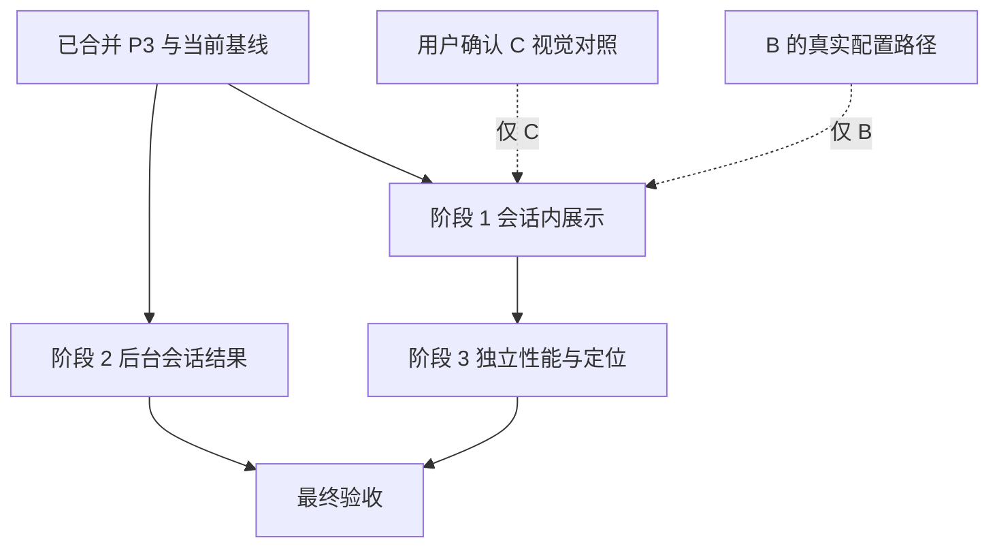

# 会话执行体验 P4 技术审查与实施规划

审查日期 2026-11-16。本文用于确定 P4 取舍和后续验收。P4-A 已由 PR #91 合并；
P4-B 已实现并验收，P4-C 已按用户确认的方案落地正式 CSS，记录见
[P4-B/C 验收](session-ux-phase4bc-acceptance.md) 与
[P4-C 方案与实施记录](session-ux-phase4c-visual-proposal.md)。
本文保留当时的规划与基线调查。

## 1. 基线、P3 合并与冻结范围

- 本地 `feat/session-ux-phase-3` 停在 `8d1f1ad363f3abf25738cde7b40cc46ccd7c6c26`。`git fetch origin --tags` 后，远端 `main` 为 `0683b89ad883731ab7b77ef849f56d99bef88cfa`。两者 tree 均为 `67e1990c65c39be9ce4ccb2aebbd75893fea5c59`，`git diff HEAD origin/main` 无差异。会话 UX P3 已由 PR #90 合并。最新 Release 为 `v0.34.0`，属于独立的发布基线。 [合并记录](https://github.com/HYJ1817/pi-gui/pull/90) · [Release](https://github.com/HYJ1817/pi-gui/releases/tag/v0.34.0)
- 两条 CI 均为 attempt 1，计划、五组 canonical、Electron build check、CI gate 共 8/8 成功。PR 运行 `43812287415` 的 GitHub API head 为 `8d1f1ad`。main 精确 SHA 的 push CI `43817291293` 已完成。 [PR CI](https://github.com/HYJ1817/pi-gui/actions/runs/43812287415) · [main CI](https://github.com/HYJ1817/pi-gui/actions/runs/43817291293)
- 开始时无 tracked diff。已有未跟踪 `conpty.exp`、`conpty.lib`、`conpty.obj`、`path_util.obj`、`spike/`、`tmp-p3-shots.log`、`win_delay_load_hook.obj`。基线测量使用临时浏览器 profile、合成会话和离线 harness，证据放在系统临时目录。
- P1 的轮次终态与重试详情分别由 `turn-outcome.js`、`messages.js` 和 Runtime 投影承载。P2 的 Classic 书签、展开锚点、展开工具跟随和 Runtime 容器内定位继续沿用。P3 现有工具组计数、可信耗时、用户折叠优先、任务折叠摘要、共用 usage 视图和布局都是起点。Runtime `session-history.js` 复用 `timelineFromMessages`，`cloneBlock` 白名单保留 usage，重复 `turnId` 的 plan-only 更新归并成一张 Plan Card，按助手消息顺序保留多条真实 usage。 [P1 验收](session-ux-phase1-acceptance.md) · [P2 最终验收](session-ux-phase2-final-acceptance.md) · [P3 最终验收](session-ux-phase3-acceptance.md)
- 本轮定向基线共 666/666，分别为 `session-ux-phase1` 81/81、`session-ux-phase2` 96/96、`session-ux-phase3` 128/128、`subagents` 141/141、`runtime-history-search` 37/37、`runtime-registry` 36/36、`session-background-ui` 9/9、`runtime-finish-ui` 48/48、`thinking-dots` 90/90。命令为逐项 `node tests/<套件>.cjs`。按本轮范围跳过完整 `npm test` 和产物重建。
- 残余问题包括 Classic 重建长任务、Runtime 最近 240 block/1 MiB 投影边界及裁掉命中项后的定位缺口。真实读屏、正常 Electron 沙箱下的 P4 交互、打包应用手测、真实模型长会话仍无本次证据。P3 归档的视图终态和 per-message usage 粒度足以继续规划。

**冻结条款**　`public/thinking-dots.js`、`public/thinking-dots.css` 及所有动画调用点、相位、关键帧、节奏和触发时机锁定。P1–P3 的轮次终态、错误重试信息、阅读位置恢复、折叠锚点补偿、工具输出跟随、Token 用量、Runtime 历史 usage、多条 Plan usage 归属纳入每个相关阶段的回归门槛。缺陷另立复现和修复范围。

参考已读 [旧源码对照审计](session-ux-comparison-audit.md)、[会话界面](conversation-ui.md)、[全局 UI/UX 设计规范](ui/design-system.md)、[开发约定](../AGENTS.md)、[审查规则](../REVIEW.md) 和 [测试执行政策](testing.md#测试执行政策)。

## 2. PI-Desktop 当前参考价值

复核上游 `main` 的 `29043af3371122e256bf265db31651da125d38e3`。旧审计固定在 `043d11c`，下表以当前实现和数据依赖为准。 [上游提交](https://github.com/vastsa/PI-Desktop/commit/29043af3371122e256bf265db31651da125d38e3)

| 对照 | 当前上游做法 | pi-GUI 的设计选择 |
| --- | --- | --- |
| A 子代理 | `ActivityGroup` 从委派工具项收集状态，拓扑行展示 Agent、Model、状态与已有步骤数。`SubagentRunRows` 消费实际嵌套 run、渲染 Child 行并独立跟随。 | 采用摘要与按需详情的层级。pi-GUI 只有父工具事实，卡片内陈列允许字段，保持工具的原位和生命周期。Child Transcript、拓扑详情面板和单独 Stop 依赖上游自己的数据与控制面。 [ActivityGroup](https://github.com/vastsa/PI-Desktop/blob/29043af3371122e256bf265db31651da125d38e3/apps/desktop/src/features/chat/transcript/ActivityGroup.tsx) · [ToolRow](https://github.com/vastsa/PI-Desktop/blob/29043af3371122e256bf265db31651da125d38e3/apps/desktop/src/features/chat/transcript/ToolRow.tsx#L406) · [SubagentRunRows](https://github.com/vastsa/PI-Desktop/blob/29043af3371122e256bf265db31651da125d38e3/apps/desktop/src/features/chat/transcript/ToolRow.tsx#L621) |
| B 错误 | `AssistantErrorMessage` 使用结构化 code 和网络 errno，错误原文有展开区。配置错误进 Settings；Continue 实际发送新 prompt，组件另有 dismiss。 | 采用结构化证据驱动的设置入口与就地错误保留。重新发 prompt 有独立执行语义，移植会重放用户未选择的操作。 [AssistantErrorMessage](https://github.com/vastsa/PI-Desktop/blob/29043af3371122e256bf265db31651da125d38e3/apps/desktop/src/features/chat/transcript/shared.tsx#L227) |
| C 密度 | `chat-shell.css` 共用 760px 的 transcript、prose 与 Composer 宽度基准。 | pi-GUI 已有相同级别的宽度轴。优先改善窄窗净宽和连续状态块的垂直留白，复用自身 Token。 [chat-shell.css](https://github.com/vastsa/PI-Desktop/blob/29043af3371122e256bf265db31651da125d38e3/apps/desktop/src/styles/chat-shell.css#L48) |
| D 长历史 | `messages.css` 对部分 DOM 使用 `content-visibility`，加载量、DOM 挂载量另有约束。首批 15 行，稳态尾部 60 行，向上每次扩 40 行，再请求更早的页。 | 借鉴「绘制、挂载、读取」三处分别测量及用真实锚点确认稳定。当前结论由 Classic 和 Runtime 各自的量测决定。 [messages.css](https://github.com/vastsa/PI-Desktop/blob/29043af3371122e256bf265db31651da125d38e3/apps/desktop/src/styles/messages.css#L12) · [transcript-window.ts](https://github.com/vastsa/PI-Desktop/blob/29043af3371122e256bf265db31651da125d38e3/apps/desktop/src/lib/transcript-window.ts) |
| E 后台 | 终态由持有 session 和 turn 身份的 main 进程提交，通知受焦点状态约束。任务的系统通知在 app 未聚焦时才显示。 | 采用会话级终态标识、已看去重和显式跳转。pi-GUI 先增强工作区内的 attention，不建立桌面 inbox、系统通知和跨重启持久层。 [终态结算](https://github.com/vastsa/PI-Desktop/blob/29043af3371122e256bf265db31651da125d38e3/apps/desktop/electron/main/runtime/plans.ts#L122) · [通知策略](https://github.com/vastsa/PI-Desktop/blob/29043af3371122e256bf265db31651da125d38e3/apps/desktop/electron/main/notification-policy.ts) |

## 3. P4-A 子代理紧凑卡片｜建议实施

**现状与缺口。** `subagent-activity.js` 承认 `subagent`、`bg_wait`、`subagents_enable`、`subagent_supervisor`。`tool-view.js:updateEntry` 使用其 `label/status/summary/facts`，把允许字段拼成详情文本并屏蔽 raw args/details。并行子项已可出现在事实文本里，但在长行中难以逐项比较。Classic `tools.js` 将实时事件转为 `ToolEntry`，`messages.js` 与 `tool-history.js` 重建记录中已有事实。Runtime 实时 `runtime-store.js` 和历史 `runtime-timeline.js` 给 `runtime-conversation.js` 的工具块主要是 `id/name/state/waiting/durationMs`，有意缩减参数和结果。即使双方共用 `renderEntry`，当前 Runtime 工具投影没有子代理事实，不能凭工具名补画卡片。 [子代理契约](subagents.md)

| 想展示的内容 | 可用证据和边界 |
| --- | --- |
| 名称与模型 | 已观察的 `details.results[].agent/model` 或绑定的 `workflowChildren.children[]`。`args.agent/task` 只能作为请求摘要。模型缺失时省略。 |
| 状态和执行步骤 | Child 状态来自 workflow state 或 result 标志、exit code、success。可显示当前工具及实际 `toolCount/turnCount/tokens/durationMs`；没有逐步 transcript 或可靠总步骤。执行了 N 个工具与完成比例语义不同。 |
| 任务进度与结果 | 允许明确的运行中、退出、失败、停止、中断、脱离；`bg_wait.completions` 仅补充它实际确认的结果。后台已启动后状态仍未知的项明示归属。任务短标题可读已有 allowlist；Child 原始输出、错误正文和脚本路径留在既有边界内。 |
| 多任务身份 | workflow 必须通过版本、父 `toolCallId` 和 `workflowRunId` 绑定。稳定键优先 childId，普通结果仅在已确认 runId 时用 producer index。绑定或去重证据不足时展示安全摘要，保留现有事实细节。沿用每个来源最多 24 项及 8,000 字符事实预算，显示已有截断语义。 |

**推荐结构。** 一次委派仍占所辖 Tool Group 中的一行。父行用现有名称、父状态、计数和 disclosure，展开后是单列子项。宽窗在子项同行布置名称、状态、模型，700px 时模型和可见进度换到第二行。多个父工具保持原来的事件顺序。使用 `textContent`，折叠和焦点走 `tool-view.js` 现有契约；父组折叠选择优先。`subagents_enable`、控制调用、无法确认归属的 `bg_wait` 和缺少事实的条目回到现有安全工具行，测试父子同时出现时保持 `gui_plan` 唯一。子项无需再设独立滚动区或停止控件。

**成本和边界。** Classic 中等，约 1.5–2.5 人日。核心触点 `public/subagent-activity.js`、`public/tool-view.js` 和共享工具行样式 `public/styles.css`。先允许在既有模型上增加有界的结构化视图，保留现有事实字符串用于缺失/未知形状。Runtime 补齐 facts 属单独有条件的契约工作，需要实测 producer → live/history → clone/budget 的最小字段与 owner 隔离再立项。P4 交付接受 Runtime 安全工具行回退。

**防回归。** `tests/subagents.cjs`、`tests/agent-execution-ui.cjs`、`tests/session-ux-phase{1,2,3}.cjs` 与 `tests/runtime-conversation.cjs`。夹具覆盖同步/并行、多模型、空 details、恶意额外字段、限长、混合终态、未知后台完成、过期运行帧。验收两种视口与主题、键盘开合、保持展开、父组锚点、同页没有第二份任务列表。回滚 A 的展示提交即可恢复原来文本事实。

## 4. P4-B 错误恢复动作｜有条件实施

**现状与缺口。** Classic `messages.js` 中 `ERR_RULES` 从错误文本给出提示，`errorBlock` 保留到达 renderer 的安全原文，`app.js` 在 `auto_retry_start/end` 管理错误快照和提示。`model-generation.js` 对消息、重试和 preflight 做安全归一化，`public/model-fallback.js` 有结构化分类与内部 replay owner。Runtime 投影展示消息、业务状态和 `generation_failed`，历史视图天然更少错误上下文。分类来源不同，Classic 的文本规则（如 `permission denied`、`403`、`404`）有多义性，结构化的模型 `auth_error` 也合并 401/403。用户面对「检查模型」还要自行找入口。

| 有证据的错误 | 可用动作和判定 |
| --- | --- |
| 模型供应商身份、认证、配置 | 显示「打开模型供应商」或「查看供应商认证」，条件是由当前会话的受信模型归属与可信认证/模型配置类别确认，且能调用 `providers.js:openProvidersPanel/openProviderAuthPanel`。入口只打开既有设置。保存、OAuth、切模型和同步继续受原契约约束。缺 provider 身份时可用供应商总览，但原因仍须可信。 |
| 模型配置与可用列表 | 有当前模型不可用的结构化证据可引导到模型设置。真实 `set_model` 存在并有当前 owner、就绪、空闲和可见列表检查，用户在现有 picker 选择。错误卡不自动选模型。 |
| 网络、限流、余额、5xx | 保留安全错误和建议。自动重试来自真实 Pi retry，受控备用路由走既有 guard。`retryable` 是备用分类条件，不能当成任意重发授权。余额入口属于模型服务商，现有应用入口未证明一键恢复。 |
| 权限、待审批、失效 owner、进程清理 | 留在审批、生命周期或清理的既有入口。上游 403 可能是账号/模型访问，普通文件错误和 Runtime 的 `stale_approval`、`runtime_busy`、`auth_syncing` 意义各异。仅凭子串不做动作。 |
| 读取失败、未知错误、继续执行 | 历史读取已有「打开历史」，Runtime lifecycle 恢复/重启系独立行为。经典恢复会话与运行中 `steer`/`follow_up` 语义不同。Runtime command allowlist 无 resume-last-generation，现有 `prompt` 会创建新的执行并可能重复工具副作用。P4 不提供通用「继续」或主动重放按钮。 |

**实施门槛和验收。** 先为 Classic 当前会话证明一次结构化 provider/model 配置错误到设置弹窗的完整路径，处理过时错误、dismiss/关闭回焦、切走会话和打开失败。错误内容、轮次、重试阶段和操作失败提示是不同的 DOM 状态，设置失败只加就地提示。历史只读及 Runtime 只有通用 `generation_failed` 时保持现有展示。合成 401、403、404、网络、限流、未知、取消、过期 owner 与加载失败，断言“不发 prompt、不重试、不换模型、不泄漏凭据”，失败前后原错误相同。使用 `tests/model-fallback.cjs`、`tests/session-ux-phase1.cjs`、`tests/provider-auth.cjs`、`tests/runtime-models.cjs`。优先在 `public/app.js` 组合已有设置回调，`public/messages.js` 增加允许列表映射与按钮；证据缺失时本阶段跳过 B，需要新授权或修改可信分类语义时另行审查。约 0.5–1.5 人日。回滚单个动作提交即可移除入口。

## 5. P4-C 信息密度｜已实施

**现状和机会。** `tokens.css`、`styles.css`、`agent-execution.css`、`runtime-conversation.css` 按此相对顺序加载。阅读列基线 `--conversation-max-width: var(--ds-composer-width)` 为 760px。Chrome 在 1320×820 下 Classic 工具区净宽 696px，Runtime 686px（10px 稳定滚动槽）。700×600 下 Classic 净宽 428px（460 减 32px 内边距），Runtime 净宽 366px（440 减 64px 内边距和 10px 滚动槽）。这 62px 差距增加了窄窗 Plan 与状态文字的换行压力。各矩阵 `scrollWidth - clientWidth = 0`，700px 代表场景 Composer 可达，Runtime 无正文重叠。宽窗截图中轮次与工具、任务卡之间仍有可节省的空白。缩小正文或点击目标会削弱实际收益。

| 已实施修改 | 生效位置、现状 → 实施值 | 结果 |
| --- | --- | --- |
| 阅读列与窄窗内边距 | `--ds-composer-width` 760px 继续共享。`runtime-conversation.css` 在 `max-width:700px` 让 `.rtc-output` 的横向 padding 从 `--ui-space-6` 对应的 32px 改用 `--ui-space-5` 24px，Classic 同断点已有 16px。 | Runtime 净宽 +16px；继续保留自身 10px 滚动槽及容器布局。 |
| 轮次留白 | `styles.css` 的 Classic `--turn-gap:36px` 改用 `--ui-space-6` 32px，Runtime 不重定义轮次语义。 | 每次 Classic 的用户轮次起始少 4px，仍有清晰分隔。 |
| 工具组与 Plan | `.tl-group` 外距 9/18px → `--ui-space-2/4` 的 8/16px，计划卡 `8/16px` → `--ui-space-2/3` 的 8/12px，在 `agent-execution.css` 让 Classic `.plan-card` 和 Runtime 外壳共用外距规则。Plan 头可将 7/11px padding 收为 6/`--ui-space-2`，保留 34px min-height 和长标题换行。 | 折叠块序列更紧凑，避免 Runtime 内外层双重边距。 |
| 工具行与辅助文字 | `--tool-row-height` 使用现有 30px，保留状态、上下分组线和 8px 行间隔。先将工具状态/耗时、Plan 次要状态硬编码 10.5/11px 映射到 `--text-xs` 11px、`--leading-normal` 1.4。主要披露标题 12px 映射 `--text-sm`，正文沿用 `--text-base` 14px / `--leading-prose` 1.6，usage 的现有精度和样式基线独立保留。 | 提升辅助文字的放大表现和同角色一致性，容许窄窗状态换行。工具 `.tl-item` 的 4px 垂直 padding 和现有 min-height 优先保留。 |
| Thinking 文本区 | Classic `.think` 外距 7/14px、Runtime `.ui2-runtime-thinking(-wrap)` 8/10px，统一为 `--ui-space-2/3` 8/12px。文字仍是 12px 级，明细沿用现有行高、滚动与公开方式。 | 缩小两套容器的间距差异，只影响思考内容块。 |

**实施与证据。** 2026-11-16 用户确认后，按上述值修改
`public/styles.css`、`public/agent-execution.css`、`public/runtime-conversation.css`，
未改 `public/tokens.css`。真实 Chromium 用同一夹具、滚动锚点、视口与主题生成
29 张前后截图，断言 128/128；矩阵、699/701、125% 字体缩放、reduced motion、
键盘焦点与右栏宽度见 [P4-C 方案与实施记录](session-ux-phase4c-visual-proposal.md)
和 [measurements.json](ui/session-ux-phase4bc-evidence/p4c/measurements.json)。

**验收。** 1320×820 / 700×600 各深浅，补 699/701px 和默认及 125% 字体缩放，键盘聚焦、短/长中英文状态、运行/终态、Thinking 展开、详情、双 usage 和书签。普通文字至少 4.5:1，非文本控件与焦点 3:1，零横向溢出、Composer 无遮挡、锚点偏移 ≤1px。实施后 Runtime 窄窗净宽为 382px，现有阅读轴上同高度能容纳更多连续状态块且避免状态吞字。涉及 `public/styles.css`、`public/runtime-conversation.css`、`public/agent-execution.css`；`public/tokens.css` 作为现有变量提供者，优先在消费端映射。约 1–1.5 人日，按一个 CSS 提交回滚。 [唯一视觉验收规范](ui/design-system.md#视觉验收)

## 6. P4-D 长会话性能｜有条件实施 Classic 优化，暂缓窗口化

### 当次测量

复用 `tests/session-ux-phase3-perf.cjs` 和 `tests/visual-harness.cjs`，在系统临时目录复制测量入口并补充夹具和采样。Windows x64、Core i7-13620H、约 16 GiB、Headless Chrome 157（脚本沿用 `--disable-gpu --no-sandbox`）、Node 24.22.1。会话 A、B 各 809 条输入，520 条用户/助手正文、220 个通用工具调用、7 个 Plan 调用、17 段 Thinking，含长工具输出。Classic 用真实 `rebuildFromMessages`，Runtime 用真实投影及视图，历史响应为回环夹具替身。没有运行真实 Pi。五个独立浏览器 profile 按同一顺序执行，每项计时包括浏览器两帧等待。首屏为同步重建或打开历史的触发到两次 rAF，非整应用启动耗时。Runtime 切换数值从点击「打开历史」起算，不含 `show()` 后夹具的 50ms 等待；回切可命中先前视图状态。JS heap 是同一 renderer 中的快照，包含共享页面和前序 Classic 测量，不能当作单会话或整个 Electron 的常驻内存。

| 指标 | Classic | Runtime 历史 |
| --- | ---: | ---: |
| 首次渲染，中位数（范围） | 163.3 ms（155.7–188.9） | 58.0 ms（48.0–84.8） |
| A→B / B→A，中位数 | 146.9 / 154.3 ms | 56.1 / 37.8 ms |
| 首屏 long tasks 与单次最大值 | 每轮 2–3 个，127–161 ms | 4/5 轮为 0，有一轮 64 ms |
| 切换 long tasks | 每次 1 个，116–149 ms | 0/10 次有 long task |
| 跳到底部 / 中段，中位数 | 27.8 / 37.4 ms | 28.0 / 33.1 ms |
| 45 帧连续滚动，五轮帧间隔 p95 范围 | 17.9–21.8 ms | 17.6–18.2 ms |
| 工具组展开 / 折叠，中位数 | 29.5 / 27.9 ms | 33.3 / 33.4 ms |
| Classic 长输出详情开 / 合，3 轮中位数 | 50.8 / 62.9 ms | 投影无原始详情，用工具组路径验证 |
| 输出内元素节点数 / 文档元素节点数 | 11,950 / 12,989 | 7,242 / 20,232（同页 Classic DOM 仍在） |
| 切换后的 renderer JS heap 中位数 | 约 8.64 MB | 约 11.02 MB |

两种模式的连续滚动均无 ≥50ms 帧间隔，五轮错误与 A/B 可见正文串扰均为 0。Classic 工具组展开锚点绝对位移最大约 0.14px。Runtime 可见 240 block，其中 86 用户、86 助手、6 Thinking、7 Plan、55 工具组。长正文压力变体保留 124 block、`truncated=true`，说明可以先触发字符预算。1 MiB 是 `MAX_TIMELINE_CHARS = 1024*1024` 的文本计数预算，另有单块/单工具字段上限，计量不等于 JSON 传输字节。实时限制走 `runtime-store.js`，历史限制走 `runtime-timeline.js`；历史接口还包有独立的 owner/locator 读取与文本投影限制。 [时间线与会话边界](conversation-ui.md#runtime-执行时间线)

**搜索分层采样。** 真实 `createSessionSearch.search` 扫 3 份临时 JSONL，各 810 条，合计 2,041,242 B。7 轮每轮一个新实例并重复同一查询，服务内冷/热缓存中位数 14.26 / 8.29 ms，均为 1 个会话、2 个匹配，无跳过和截断。系统文件缓存未清空，计时未含输入 debounce、HTTP 和搜索结果 UI。另在 Chromium 调真实 Runtime `openHistory(locator, match)`，含历史视图加载与两帧等待。保留项 3 轮中位数 83.4 ms，居中误差 0.375px，`.stage` 滚动为 0。裁剪项 3 轮同样返回打开成功（中位数 82.9 ms），输出找不到目标行。随后切回可见的 Classic 容器，程序触发长输出详情，三轮开合耗时分别在 37.9–64.2 ms 和 45.8–82.3 ms 之间，样本量和波动不足以归因。未测大项目历史搜索端到端高分位、真实鼠标滚轮、连续切换的留存堆及 Electron 资源占用。原始记录在 `%TEMP%/pi-gui-p4-0683b89/sample-{1..5}/performance.json`、`loc-{1..3}/performance.json`、`search.json`。仓库外测量入口为同目录的 `perf.cjs`、`location-verified.cjs`、`search.cjs`。

**可复现的现有缺口 D-1。** `public/runtime-conversation.js:1095–1102,1285–1294` 优先渲染有界时间线，并尝试查找对应 messageId 或 userIndex。用已有 `tests/runtime-history-search.cjs` 契约造原生记录，在第一个用户项放唯一命中词，随后追加超出 240 block 的混合内容并点早期结果。locator 可通过，`openHistory()` 返回成功，但视图只显示最近的块，命中无法定位。触发条件是合法搜索命中与可见投影范围不同。规划上先让缺失位置显式可知，保留原会话和原预算；需要加载命中附近上下文时独立验证同 owner/locator、读量、可见字段、操作取消与向后兼容，等待单独授权决策。

### 候选与采用门槛

| 方案 | 本轮取舍 |
| --- | --- |
| 分段渲染 Classic | 最值得验证。`messages.js:rebuildFromMessages` 同步遍历完整消息、创建 DOM、渲染富文本、重建 Minimap 和恢复书签，真实 5/5 轮首屏产生 >100ms 任务。先 trace 区分 Markdown/高亮、DOM 构建和布局，随后试受时间预算控制的分段构建，按 session/thread generation 取消旧构建。按目标锚点保留完整输出和销毁路径，对收尾的 Minimap/书签处理给出顺序与完成状态。 |
| `content-visibility` | 可做局部实验。偏向减少离屏布局和 paint，DOM、事件和数据仍保留；当前连续滚动不足以支持启用。若 trace 指向布局，才对完整冷块试验，验证内在高度估算、Minimap 测高、滚动恢复、浏览器查找与 print。 |
| 列表窗口化 | 暂缓。当前瓶颈集中在 Classic 重建，先证明分段不足。只有更大真实规模出现持续滚动或驻留 DOM/堆瓶颈，并可设计逻辑锚点、完整复制/打印和载入策略时再立项，保留原 240 block/1 MiB Runtime 限制。 |
| 历史延迟加载 | Runtime 本身已有按需打开的有界只读历史。仅 D-1 若需要读取命中附近内容，评估以 locator 为边界的窄查询或分页；当前 3 文件搜索计时不足以支持通用分页。Classic 先保持全量数据语义。 |

**依赖与风险。** Classic `conversation-nav.js` 依据全部 `.msg.user` 的位置维护 Minimap，`sessions.js` 的旧历史命中通过 `userIndex` 和 `scrollToUserTurn` 落位。DOM 分段须等目标/索引准备好，再恢复书签、对齐 Minimap、接受 live 增量。Runtime 依赖 `conversationId + nativeSessionId + projectId/workspaceId/workspaceEpoch` 校验 locator，再在 `.rtc-output` 内滚动。展开键绑定会话和 block/tool ID；`ui/message-actions.js` 复制已捕获的消息全文，鼠选和浏览器页面打印依赖已呈现内容。审查范围未发现会话专用打印出口，按浏览器打印现状作基线，比较打印文字顺序和完整性。分段必须保证完整已加载范围可复制、可打印，或在处理完毕前把未完成状态说清。不得按当前可见 DOM 重写数据契约。

**交付门槛。** 以未变基线和候选分别跑至少 5 轮相同基准，再用正常 Electron 补带真实滚轮与多次 A→B→A 的跟踪。目标 Classic 首屏/切换中位数或最慢任务时长至少改善 30%，可交互前无 ≥100ms 同步段，画面总就绪时间和稳定后的 heap 不比基线恶化超过 10%。这是候选决策阈值。覆盖首尾命中与裁剪外命中、A/B 快速切换和过期批次取消、反复展开、跟随/不跟随、Minimap 位置与键盘、书签偏移 ≤1px、逐条复制和选择全文、打印对照、实时插入、退订与垃圾回收。主候选触点 `public/messages.js`、`public/conversation-nav.js`，按实际调用需要才改 `session-navigation.js`。D-1 若仅提示，归 `runtime-conversation.js` 和 `tests/runtime-history-search.cjs`；扩大历史读取须另立高风险决策。分段和定位提示分提交，可分别恢复同步重建及现有历史行为。约 3–5 人日，包含 trace 与候选去留，窗口化或历史分页未计入。

## 7. P4-E 后台会话完成提示｜建议实施

**真实来源。** `server/runtime-registry.js:113–176,351–370` 持有 live runtime 的 `attention`。后台 `agent_settled`、bridge error/exited、extension UI/error 和 generation 失败等都会置位，经 runtime session snapshot 广播。现有成功的 owner-validated `focus` 会清除，`runtime-nav.js` 用「需要注意」点及 `focusRuntimeById`，`runtime-sessions.js` 把同一 flag 称为「未读」。attention 混合了完成与需要操作的状态。`agent_settled` 是整个运行结束的证据（包括 retry/compaction 的等待），单独不足以判定成功。`generationResult` 有归属，但 failed 可含 aborted，prompt preflight 失败也可发出，`steer/follow_up/abort` 还可能使该归属不可用。`stop_state.pending=false` 仅证明停止屏障清理完成，`idle` 也可能来自拒绝/启动回退。

**建议行为。** 在现有 Runtime 列表上提供后台终态的文字原因。当前项目有多条时，用一个「N 个后台会话有结果」入口打开既有的 Runtime 会话列表或聚焦该组，按会话聚合，单条点击经 `focusRuntimeById` 导航。每条只计一个未查看的最新终态，普通完成用平静状态、失败和中断用可辨文字。后台更新只修改列表及计数，不抢 Composer 焦点、不改草稿和执行。审批/扩展 attention 仍有效并保留独立语义。

**权威判定和去重。** 在 registry 对同一当前 owner（含 backend 实例、项目/工作区、runtime generation、session identity）绑定已观察的执行起点和一次终态。记录一个有界的终态类型与现有事件序号或等价身份，按 conversation 去重。`agent_settled` 配合可信 assistant 终态或适用的 `generationResult`，有明确归属和成功证据才写「已完成」；失败、中断各按自己的真实状态证据，缺失时「已结束」或保留通用 attention。已观察到的活跃轮次若 bridge 确认退出，可记「运行异常／中断」，不把连接断线或历史 replay 当成错误。SSE 重复、补帧、快照、reload 都只重新对账，不触发第二次通知；`runtime-recovery.js` 的补帧走 observe 路径，不能仅用 `_replay` 过滤。用现有受校验 focus 成功后清除当时看见的版本；测试点击与新运行结束的竞争，同一条新的 outcome 应保留。若中心切换被更晚的用户 intent 淘汰或目标换代，旧响应不能夺回视图或清除下一代结果。仅工作区内提示，存续范围随现有 live record，初版无跨重启持久化和 Classic 单会话通知中心。

**成本与验收。** 约 2–3 人日。触点 `server/runtime-registry.js`、`public/runtime-store.js` 或 `runtime-state.js` 的快照与 owner 接收、`public/runtime-nav.js`、`public/runtime-sessions.js`、组合根 `public/app.js` 仅在复用入口需要时。优先回归 `tests/runtime-registry.cjs`、`tests/runtime-events.cjs`、`tests/runtime-store.cjs`、`tests/runtime-nav.cjs`、`tests/runtime-finish-ui.cjs`、`tests/session-background-ui.cjs` 和 `tests/session-background-recovery.cjs`。覆盖前台/后台 A/B/C、并行终态、真实失败/停止/中断、未知、审批共存、preflight、重试中、关闭/换代、重复/反序、snapshot/reconnect 补帧、跨项目、过时点击、失败的 focus、仅成功查看后清除。真实浏览器验证计数与目标、工作区未自动切换，当前输入内容、键盘焦点、位置与运行标识稳定。保留兼容 `attention` 布尔项，回退 UI/可选终态元信息提交可直接恢复原来的点和列表。

## 8. 推荐实施顺序与回滚边界

推荐 3 个验收阶段。A 的 Classic 卡片与 E 的 Runtime 会话提示是直接建设项。B 在真实设置路径成立时随展示批落地。C 在视觉确认后进入同一批。D 针对已复现的 Classic 重建问题做独立实验并按收益决定合入；保留一个小型 Runtime 搜索缺失提示的交付路径。估算为单人日，包含开发、定向测试和视觉取证，CI 排队及用户确认时间另计。

`Base → Attention` 可独立验收。若 1/2 同时进行，共用的 `app.js` 集成点按提交顺序协调。阶段 3 可先做 profiling，候选的正式性能对照要固定展示基线，以免卡片和样式的节点数变化混入收益测量。

| 阶段 | 工作及文件 | 独立交付、验收与回滚 |
| --- | --- | --- |
| 1．会话内展示（A + 通过门槛的 B/C，约 2–5.5 人日） | A `subagent-activity.js`、`tool-view.js`、`styles.css`；B `messages.js`、`app.js`，复用 `providers.js`；C `styles.css`、`agent-execution.css`、`runtime-conversation.css`，读取 `tokens.css`。测试沿 3–5 节列出的现有套件与截图入口。 | 提交分别对应 A、B、C。实测有/无 facts 回退、控制操作边界、原错误保留及真实设置路径，C 先用户确认并完成四组视觉/焦点/对比度对照。任一门槛缺失可跳过相应工作，回滚对应提交即可。 |
| 2．后台会话结果（E，约 2–3 人日） | `runtime-registry.js`、Runtime store/state、导航及会话列表，必要时组合根。第 7 节套件及双会话浏览器证据。 | 有权威可归属的终态才提示，按会话聚合、可恢复导航、不改现有执行。关注 `focus`、补帧与换代；独立审查状态与隔离。回滚 E 的展示和 snapshot 字段，原 attention 仍可用。 |
| 3．独立性能与定位（D，约 3–5 人日） | `messages.js`、`conversation-nav.js`、必要的 `session-navigation.js` 与 `runtime-conversation.js`；沿用 `tests/session-ux-phase{2,3}.cjs`、`tests/session-ux-phase{2-shots,3-perf}.cjs`、`tests/runtime-history-search.cjs`、`tests/session-search.cjs`。 | 输出 trace、五轮前后数据与采用/放弃结论，满足第 6 节门槛才合入分段。Classic 分段与 Runtime 缺失定位反馈分别回滚。任何扩大历史数据范围或 owner 契约的提案独立审查，并由用户明确决策。 |

后续实施优先补进入现有 suite 的针对性回归，继续以 `npm test` 链为唯一 canonical 清单。按当次 PR/提交取得完整 canonical 证明，保留专项功能与安全审查。UI 改动需重建应用产物并注明源代码、稳定 Chrome 与 Electron 测试覆盖的差别。阶段可独立 revert，回滚后重建并复跑针对受影响路径的检查。

## 9. 最终验收清单与开工条件

- [ ] 从已合并且精确 SHA 的 main 重新确认基线和工作区保护，已定向通过的证据绑定相同树；开始实施以用户后续指令为准。
- [ ] A 有事实时可快速识别并行子项及结果，缺字段按安全工具行回退；数据来源、状态、模型、计数和停止权限正确，`gui_plan` 无重复。
- [ ] B 若纳入，只提供有可信证据和真实入口的恢复指引；设置操作、取消和失败后原错误与重试信息都可见，重放和隐式执行为零。
- [ ] C 若纳入，用户确认视觉对照，已验收矩阵、状态/焦点、字体缩放、对比度与窄窗 Composer。
- [ ] E 的结果来自真实终态，列表聚合和点击目标正确，重复帧、换代、取消及错误不误报，工作中的会话保持输入与执行归属。
- [ ] D 记录当前与候选同口径结果及取舍。若采用分段，Minimap、搜索、完整复制、展开、书签、工具跟随、打印与跨会话隔离通过。Runtime 有界裁剪与读取授权经针对性回归。
- [ ] 两个动画文件及全部调用点逐项对照基线。P1–P3 冻结功能逐项定向、截图与完整 canonical 证明齐备；记录断言变化、跳过、平台和风险，产物已重建或明确源码验证边界。
- [ ] `git diff --check`、审查、验收、回滚记录完整。合并和发布分别等待用户授权。

**开工判断。** 已具备从 main 开始 A 和 E 的技术条件。B、C 及 D 上线分别受可信动作、用户视觉确认及性能收益约束。最高难度是 D 中保持 Classic 的消息、锚点和导航在异步渲染与会话切换中一致。若后续提出 Runtime 历史分页，其读取权限和定位契约单独评估。
