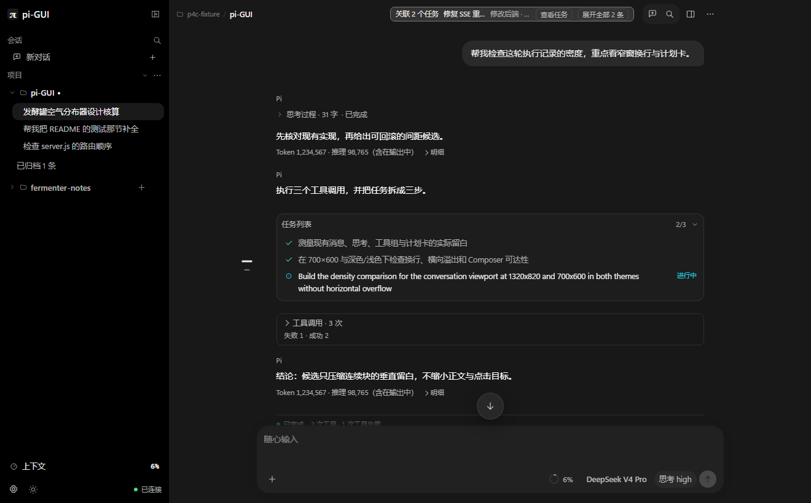
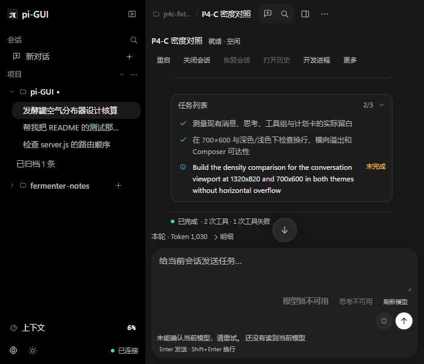
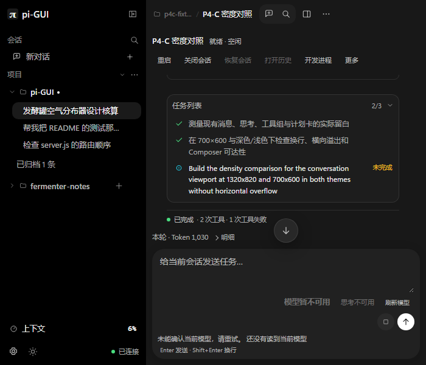

# 会话执行体验 P4-C 信息密度方案与实施记录

日期：2026-11-16。本文记录用户确认后落地的 P4-C 信息密度调整。正式
`public/styles.css`、`public/agent-execution.css`、`public/runtime-conversation.css`
已按第 3 节修改；`public/tokens.css` 未改。第 2 节的旧值与截图保留为修改前基线。

- 修改前回滚覆盖：[p4c-before-overrides.css](ui/session-ux-phase4bc-evidence/p4c-before-overrides.css)
- 实测与断言：[measurements.json](ui/session-ux-phase4bc-evidence/p4c/measurements.json)
- 截图目录：[p4c](ui/session-ux-phase4bc-evidence/p4c/)
- 计划依据：[P4 技术审查与实施规划](session-ux-phase4-plan.md) 第 5 节

## 1. 方法与边界

使用 `tests/visual-harness.cjs` 的离线夹具和 Windows Headless Chrome（DPR 1），
在真实 Chromium 布局里渲染同一份 Classic 与 Runtime 夹具：

- Classic：`rebuildFromMessages` 重建，包含用户消息、Thinking、正文、工具组、
  子代理卡、计划卡、两条助手 usage 和第二个轮次。
- Runtime：真实 `runtime-state.js` 与 `runtime-conversation.js`，通过
  `runtime_event` 帧生成同形状的时间线（Thinking、工具组、Plan、正文、usage、
  第二个轮次）。
- 每个视口先注入回滚覆盖截“修改前”，再移除覆盖截“修改后”；修改后直接来自
  产品 CSS，截图的滚动锚点相同。
- 尺寸：1320×820、700×600；主题：深色、浅色；另补 699×600、701×600、
  125% 字体缩放、reduced motion 与键盘焦点。
- 断言：128/128 通过；回滚覆盖未被 `public/` 任何文件引用。

仍未在真实 Electron 打包应用、真实长历史或读屏下复验；这些不阻塞本次 CSS
实施，但保留为后续验收项。

## 2. 现状审计（修改前）

### 2.1 阅读轴与窄窗净宽

| 视图 | 1320×820 净宽 | 700×600 净宽 | 现状 |
| --- | ---: | ---: | --- |
| Classic | 696px | 428px | 阅读列 760px，减去 `.thread` 32/16px 内边距 |
| Runtime | 686px | 366px | `.rtc-output` 横向 32px 内边距，另有 10px 稳定滚动槽 |
| Classic + 右栏 | 589px | — | 右栏默认 392px，主干 653px；阅读列被压到 760px 以下 |

Runtime 在窄窗比 Classic 少 62px，主要来自 64px 的左右内边距。计划卡和状态文字
因此更早换行。右栏打开时 Classic 也会被压到 589px；本轮不改右栏行为，但正式
验收需要把这一状态列入。

### 2.2 垂直留白与辅助文字

实测值来自 1320×820 深色（浅色数值一致）：

| 位置 | 现有声明 | 实测 | 观察 |
| --- | --- | --- | --- |
| Classic 轮次 | `--turn-gap:36px` | 36px | 每次用户轮次比统一间距多 4px |
| Classic Thinking | `.think{margin:7px 0 14px}` | 0/14px | 作为 `.msg-body` 首块时上边距被 `*:first-child{margin-top:0}` 清零，7px 实际很少生效 |
| 工具组 | `.tl-group{margin:9px 0 18px}` | 9/18px | Classic 与 Runtime 共用，底部比计划卡多 2px |
| 工具组标题 | `.tl-group-head` 10.5px 被 `.ui2-tool-summary` 12px 覆盖 | 12px / 19.8px | 主披露标题实际是 12px，行高不是 Token |
| 工具状态 | `.ui2-tool-state` 10.5px；`.tl-status` 10px；`.tl-group-time` 10.5px | 10.5 / 10 / 10.5px | 同一行辅助信息三种字号，低于 `--text-xs` 11px |
| Plan 卡 | `.plan-card{margin:8px 0 16px}`；≤700 时 `6px 0 13px` | 8/16；6/13px | 窄窗例外与主规则不一致 |
| Plan 头 | `padding:7px 11px;min-height:34px` | 34px 高 | 34px 点击高度合适，横向内边距偏松 |
| Plan 次要状态 | `.plan-count` / `.plan-now` 11px | 11px | 已等于 `--text-xs`，但仍硬编码 |
| Runtime Thinking | `.runtime-conversation .rtc-output .ui2-runtime-thinking{margin:8px 0 10px}` | 8/10px | 与 Classic 的 14px 底距不一致 |
| Runtime Plan 外壳 | `.ui2-runtime-plan{margin:8px 0 16px}` | 8/16px | 与 Plan 卡共用外距时形成两处规则 |
| Runtime 消息 | `.rtc-history-message{margin:0 0 14px}` | 14px | 保持不变 |
| usage | `.ui2-msg-meta` 11.5px | 11.5px | 精度与样式基线独立，本轮不改 |
| Composer 提示 | `.rtc-composer-note` 10px | 10px | 低于 `--text-3xs` 10.5px，本轮不改，另列观察项 |
| 子代理卡 | P4-A 的 `.tl-subagent-*` 11/11.5px | — | 结构、换行与父行生命周期保持原样 |

字体层级本身没有第二套系统：正文 14px / `--leading-prose`，主披露 12px，
辅助信息 10–11.5px。问题主要是辅助信息的三档硬编码和两处未消费的 Token。

## 3. 实施值

以下即正式落地的修改。全部只消费现有 Token，不新增 Design Token，不缩小正文、
点击目标或工具行最小高度。

| 修改 | 实施值 | 理由 |
| --- | --- | --- |
| 轮次 | `--turn-gap:36px → var(--ui-space-6)`（32px） | 统一到现有间距阶，仍保留轮次分隔 |
| Classic Thinking | `.think` 外距 `7/14 → var(--ui-space-2/3)`（8/12） | 与 Runtime 统一；首块上边距仍由既有规则清零 |
| 工具组 | `.tl-group` 外距 `9/18 → var(--ui-space-2/4)`（8/16） | Classic 与 Runtime 共用，减少连续块的双份留白 |
| Plan 卡 | `.plan-card` 外距 `8/16 → var(--ui-space-2/3)`（8/12）；≤700 的 `6/13` 例外同步收口 | 主规则与窄窗例外只留一份 |
| Plan 头 | `padding:7px 11px → 6px var(--ui-space-2)`（6/8），保留 `min-height:34px` | 收紧横向留白，不缩小点击高度 |
| 辅助文字 | `.tl-status`、`.ui2-tool-state`、`.tl-group-time` → `--text-xs`（11px）+ `--leading-normal`（1.4）；`.plan-count`、`.plan-now` 同 Token 化 | 同一行只用一档辅助字号，放大表现更一致 |
| 主披露标题 | `.ui2-tool-summary`、`.tl-label`、`.plan-head` → `--text-sm`（12px） | 数值不变，改为 Token 表达 |
| Runtime Thinking | `.ui2-runtime-thinking(-wrap)` 外距 `8/10 → var(--ui-space-2/3)`（8/12） | 与 Classic 一致 |
| Runtime Plan 外壳 | `.ui2-runtime-plan` 外距 `8/16 → var(--ui-space-2/3)`（8/12） | 与 Plan 卡共用外距，避免内外层叠加 |
| Runtime 窄窗 | `.rtc-output` 横向内边距 `32 → var(--ui-space-5)`（24px），垂直 20px 不变 | 净宽 366 → 382px，兑现计划中的窄窗目标 |

明确不改：正文 14px、工具行 `4px` 垂直 padding 与 30px 最小高度、usage 的精度
和样式、子代理卡结构、消息数据、Runtime 滚动槽、右栏宽度与模式。

## 4. 实测对照

### 4.1 尺寸

| 指标 | Classic 前 | Classic 后 | Runtime 前 | Runtime 后 |
| --- | ---: | ---: | ---: | ---: |
| 1320 净宽 | 696px | 696px | 686px | 686px |
| 700 净宽 | 428px | 428px | 366px | **382px** |
| 1320 内容总高 | 1057.28px | 1040.92px（−16.36） | 705px | 698px（−7） |
| 700 内容总高 | 1090.25px | 1078.89px（−11.36） | 762px | 754px（−8） |
| 轮次间距 | 36px | 32px | — | — |
| Thinking 底距 | 14px | 12px | 10px | 12px |
| 工具组外距 | 9/18px | 8/16px | 9/18px | 8/16px |
| Plan 外距 | 8/16px（窄窗 6/13） | 8/12px | 8/16px | 8/12px |
| Plan 头 | 7/11px，34px 高 | 6/8px，34px 高 | 同 Classic | 同 Classic |
| 699px Runtime（仅修改后） | — | — | — | 24px 内边距，净宽 **381px** |
| 701px Runtime（仅修改后） | — | — | — | 32px 内边距，净宽 339px |
| 125% 字体缩放 | — | — | — | 主披露 15px、辅助 13.75px，零溢出 |

701px 时 `.runtime-conversation-view` 也切回 24px 横向内边距，因此净宽 339px
小于 700px 以内；这是既有断点行为，本轮只让 `≤700px` 的 `.rtc-output` 横向
内边距与它衔接，不改变 701px 以上的布局。

### 4.2 布局与可读性

- 所有矩阵 `document`、正文容器、工具组、Plan、Plan 任务行、子代理行与
  Runtime 用户气泡的横向溢出均为 0。
- 700×600 下 Composer 完整可见（Classic 底边 600px，Runtime 底边 590px）。
- 窄窗长英文 Plan 任务换行到 3 行；子代理长名称与模型名在 384px 卡片内换行，
  `.tl-subagents` 横向溢出 0。
- 工具详情展开后 `.tl-out` 保持 `max-height:260px`，内部横向滚动；外层组溢出 0。
- 展开工具详情时计划卡顶部 225.52 → 225.52px，阅读锚点偏移 0。
- 文字对比度（深色 / 浅色）：工具组标题 9.45 / 7.34，工具状态 8.19 / 6.29，
  Plan 计数 8.19 / 6.29，usage 8.19 / 6.29，均 ≥ 4.5:1。
- 右栏打开（1320×820）：右栏 392px、主干 653px、阅读列净宽 589px。本次不改
  右栏行为，截图保留在矩阵中。
- 699px 与 701px：Runtime 在 699px 使用 24px 横向内边距、净宽 381px；701px
  回到 32px、净宽 339px，断点两侧均无横向溢出。Classic 的 900px 内边距断点
  在 699/701px 均保持 16px，阅读列零溢出。
- 125% 字体缩放（产品 `--font-scale:1.25`）：Classic 与 Runtime 的主披露字号
  15px、辅助字号 13.75px，Plan 长任务与子代理长名称继续换行，横向溢出 0，
  Composer 完整可见。
- reduced motion：计划呼吸点 `animation:none`，回到底部按钮 `transition:0s`。
- 键盘焦点：计划头 `:focus-visible` 为 2px `solid` 轮廓，焦点落点正确。

## 5. 截图

每对为同一夹具、同一滚动锚点的“修改前 / 修改后”。

| 场景 | 修改前 | 修改后 |
| --- | --- | --- |
| Classic 深色 1320 | [前](ui/session-ux-phase4bc-evidence/p4c/classic-before-dark-1320.png) | [后](ui/session-ux-phase4bc-evidence/p4c/classic-after-dark-1320.png) |
| Classic 浅色 1320 | [前](ui/session-ux-phase4bc-evidence/p4c/classic-before-light-1320.png) | [后](ui/session-ux-phase4bc-evidence/p4c/classic-after-light-1320.png) |
| Classic 深色 700 | [前](ui/session-ux-phase4bc-evidence/p4c/classic-before-dark-700.png) | [后](ui/session-ux-phase4bc-evidence/p4c/classic-after-dark-700.png) |
| Classic 浅色 700 | [前](ui/session-ux-phase4bc-evidence/p4c/classic-before-light-700.png) | [后](ui/session-ux-phase4bc-evidence/p4c/classic-after-light-700.png) |
| Runtime 深色 1320 | [前](ui/session-ux-phase4bc-evidence/p4c/runtime-before-dark-1320.png) | [后](ui/session-ux-phase4bc-evidence/p4c/runtime-after-dark-1320.png) |
| Runtime 浅色 1320 | [前](ui/session-ux-phase4bc-evidence/p4c/runtime-before-light-1320.png) | [后](ui/session-ux-phase4bc-evidence/p4c/runtime-after-light-1320.png) |
| Runtime 深色 700 | [前](ui/session-ux-phase4bc-evidence/p4c/runtime-before-dark-700.png) | [后](ui/session-ux-phase4bc-evidence/p4c/runtime-after-dark-700.png) |
| Runtime 浅色 700 | [前](ui/session-ux-phase4bc-evidence/p4c/runtime-before-light-700.png) | [后](ui/session-ux-phase4bc-evidence/p4c/runtime-after-light-700.png) |
| Classic 工具详情展开 1320 | [前](ui/session-ux-phase4bc-evidence/p4c/classic-expanded-before-dark-1320.png) | [后](ui/session-ux-phase4bc-evidence/p4c/classic-expanded-after-dark-1320.png) |
| Classic 工具详情展开 700 | [前](ui/session-ux-phase4bc-evidence/p4c/classic-expanded-before-light-700.png) | [后](ui/session-ux-phase4bc-evidence/p4c/classic-expanded-after-light-700.png) |
| Classic 子代理卡 1320 | [前](ui/session-ux-phase4bc-evidence/p4c/classic-subagent-before-dark-1320.png) | [后](ui/session-ux-phase4bc-evidence/p4c/classic-subagent-after-dark-1320.png) |
| Classic 子代理卡 700 | [前](ui/session-ux-phase4bc-evidence/p4c/classic-subagent-before-light-700.png) | [后](ui/session-ux-phase4bc-evidence/p4c/classic-subagent-after-light-700.png) |
| Classic 右栏打开 1320 | — | [现状](ui/session-ux-phase4bc-evidence/p4c/classic-right-pane-dark-1320.png) |
| Runtime 断点 699 浅色 | — | [修改后](ui/session-ux-phase4bc-evidence/p4c/runtime-boundary-699-light.png) |
| Runtime 断点 701 浅色 | — | [修改后](ui/session-ux-phase4bc-evidence/p4c/runtime-boundary-701-light.png) |
| Classic 125% 字体 700 深色 | — | [修改后](ui/session-ux-phase4bc-evidence/p4c/classic-font125-dark-700.png) |
| Runtime 125% 字体 700 深色 | — | [修改后](ui/session-ux-phase4bc-evidence/p4c/runtime-font125-dark-700.png) |

代表图：

## 6. 结论

正式实施的收益集中在两处：Runtime 窄窗净宽 +16px（366 → 382），以及连续块序列的
底部留白减少 7–16px。视觉上仍是同一套语言：没有改颜色、字号层级、卡片结构或
交互密度，只把硬编码值收回现有 Token 阶。`public/tokens.css` 未改，没有第二套
Design Token。

`node tests/session-ux-phase4c-shots.cjs`：**128/128 通过**，在原有 25 张矩阵
与展开截图基础上新增 699/701、125% 字体缩放、reduced motion 和键盘焦点检查。
`node tests/ui2-visual.cjs`：57/57 通过，组状态字号预期已随 `--text-xs` 更新。

未完成：真实 Electron 打包应用手测、真实长历史和读屏复验；这些不改变本次
CSS 结论，保留为后续验收项。回滚边界是 CSS 消费端三处规则改动加测试与证据，
不涉及消息数据或交互逻辑。
